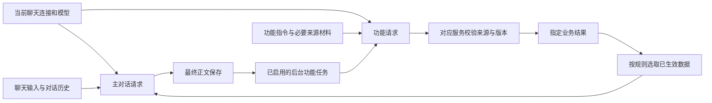

# 对话 AI 与功能 AI 会话隔离方案

> 🗄️ **已归档（2026-10-03）**：PC 通用阶段 0—4 已完成，综合真实模型联验（16 次请求、39 项检查）通过；其他客户端另行接入。本文仅作历史留档，不再更新（文内路径/行号可能失效）。归档登记见 [归档清单](./README.md)。

> 归档说明：PC 实施及综合联验已完成；保留设计与分阶段依据，其他客户端另行接入。

> 日期：2026-09-30
>
> 状态：✅ 已完成并归档（2026-10-02）— PC 通用阶段 0—4 已完成；综合真实模型联验 16 次请求、39 项检查通过。其他客户端另行接入。
>
> 已完成的 PC 实施范围：有效连接／模型解析、请求快照、单聊／群聊辅助功能归属，以及编辑版本、旧建议、导出／备份／恢复规则。通用阶段 0 见[实施报告](../../报告/对话AI与功能AI会话隔离阶段0实施报告-2026-10-02.md)，阶段 2 见[实施报告](../../报告/对话AI与功能AI会话隔离阶段2实施报告-2026-10-02.md)，阶段 3 见[实施报告](../../报告/对话AI与功能AI会话隔离阶段3实施报告-2026-10-02.md)，群聊画板验收见 §13。 综合收口见[真实模型联验报告](../../报告/对话AI与功能AI会话隔离综合真实模型联验报告-2026-10-02.md)。
>
> 用户确定：继续使用聊天的连接和模型，只把对话会话与各功能会话区分开。

## 1. 核心约定

**沿用所属聊天的连接和模型，分别组装对话与各功能的上下文。**

对话 AI 负责正常聊天。画板、翻译、标题、记忆整理、文本润色等功能使用自己的任务提示、输入和结果状态。功能需要聊天内容时，由应用选取必要材料传入；功能结果经对应服务校验后，写回指定的数据位置。

这里的“会话分开”指应用内的逻辑会话分开。使用同一模型发出多次请求，也能分别维护历史与身份。画板助手有连续历史；一次翻译只需要本次任务上下文，无须额外建立长期聊天记录。

各功能沿用现有聊天配置入口，不增加功能专属的连接档案、模型覆盖字段或选择器。

## 2. 用户使用时的体验

| 用户操作 | AI 使用的上下文 | 结果出现的位置 |
|---|---|---|
| 在聊天输入框发送、重生成或继续助手回复 | 当前角色的对话上下文 | 主聊天消息 |
| 在群聊点名、轮询或自由发言 | 当前群聊公共历史、对应发言/叙事模式的上下文 | 当前群聊消息；一次生成可能对应多条成员消息 |
| 在画板助手输入“把 Aiko 移到厨房” | 画板助手历史、当前空间状态和本条指令 | 画板助手的调整提案，确认后更新画板 |
| 生成画板初始空间 | 初始化提示、用户选定的设定与位置证据 | 空间草稿预览，确认后创建或绑定 |
| 翻译一条消息 | 翻译提示、目标消息和目标语言 | 该消息的翻译区域 |
| 生成回复方向 | 方向提示、必要的近期对话 | 方向候选，用户选择后进入正常输入流程 |
| 润色或续写用户草稿 | 草稿编辑提示、当前输入文本 | 输入框草稿，发送后才成为聊天消息 |
| 整理记忆或压缩历史 | 整理提示、指定消息范围及已有有效摘要 | 对应记忆或压缩记录 |
| 自动生成标题 | 标题提示、必要对话片段 | 会话标题 |
| 编辑角色卡、开场白或预设 | 对应编辑提示和选中的字段材料 | 编辑器草稿或明确指定的字段 |

例如，主聊天中的 Aiko 继续按角色身份对话；画板助手可以同时理解“把她移回客厅”。两者使用当前聊天模型，但画板指令与提案不进入 Aiko 的聊天历史。确认移动后，对话 AI 下一轮只读取更新后的空间关系。

现有功能的触发方式和确认方式继续保留。会话隔离本身不意味着打开更多自动调用。

## 3. 当前代码已经具备什么

当前辅助功能已有独立请求、任务提示和部分用量分类，不能将现状理解为所有功能都使用主聊天的完整 messages。

| 现有基础 | 依据 | 后续需要统一的内容 |
|---|---|---|
| 主对话上下文与连接解析 | [contextService](../../../electron/chat/contextService.ts)、[上下文提供器](../../../electron/context/mainContextProvider.ts) | 功能请求共用有效连接/模型解析，避免各处解析顺序不同 |
| 主生成终态与后台记忆任务 | [orchestrator](../../../electron/chat/orchestrator.ts)、[ports](../../../electron/chat/ports.ts) | 辅助失败保持独立；沿用正文成功保存后的触发点 |
| 任务类型、输出与推理预算 | [generationTaskBudget](../../../shared/generationTaskBudget.ts) | 在现有规划器中补画板任务类型，不建立另一套预算规则 |
| 消息翻译独立提示和请求 | [useChatStore](../../../src/store/useChatStore.ts)、[translationPrompt](../../../shared/translationPrompt.ts) | 补来源版本校验、取消与结果归属规则 |
| 方向候选独立运行器 | [dialogueDirectionRunner](../../../src/store/dialogueDirectionRunner.ts) | 采用功能专用提示，明确必要角色信息的输入范围 |
| 主进程记忆整理与版本提交 | [memorySummaryService](../../../electron/services/memorySummaryService.ts) | 保留已有版本校验，统一任务身份和配置快照 |
| 历史压缩与自动标题 | [streamController](../../../src/store/streamController.ts) | 标题和压缩分别管理来源、结果与失效条件 |
| 用户草稿与角色编辑辅助请求 | [useChatInputState](../../../src/components/chat/useChatInputState.ts)、[useCharacterCreatorStore](../../../src/store/useCharacterCreatorStore.ts) | 保留编辑器上下文，防止晚到结果覆盖用户新改动 |

当前方向候选与自动标题路径还会追加预设的 `jailbreak`。后续应逐项改为任务专用提示；任务确实需要角色设定时，选取相关字段作为材料传入，避免沿用角色对话的完整系统提示。

PC 单聊画板的独立长期会话、初始化、只读位置、确认及可选自动同步已实现，见[单聊画板实施方案](空间画板单聊读取与剧情回写实施方案-2026-09-30.md)及[阶段 4 报告](../../报告/空间画板单聊接入阶段4实施报告-2026-10-01.md)。其他功能和群聊继续按本文实施。

群聊已有单独的调度、上下文与记忆链路，不能直接套用单聊的任务归属和完成时机。群聊画板阶段 1 已让正文与记忆整理使用 `settings.activeModel || profile.model` 的有效模型快照，预算、实际发送和用量记录相符，详见 §13.1。

## 4. 连接和模型怎样沿用聊天配置

### 4.1 唯一解析入口

主对话与文本功能请求共用一个“所属聊天当前有效连接/模型”解析入口，遵循现有聊天配置的优先级。调用方提供所属单聊/群聊作用域、任务身份与输入，不提供独立的功能模型覆盖项。后台任务的所属会话不能随当前打开的页面改变。

该入口复用现有供应商适配、凭据读取、模型能力检测和请求预算规划。功能可以使用适合任务的输出长度、温度和结构化输出参数，仍受当前连接与模型实际支持能力限制。

### 4.2 配置切换的时间边界

1. 任务创建时记录所属会话、来源内容与功能类型。
2. 实际请求开始时解析当前有效聊天连接和模型，并冻结到本次请求的内存快照。
3. 本次流式请求及其内部重试使用同一配置快照。
4. 用户切换聊天连接或模型后，下一次新请求使用更新后的配置，包括尚未开始的排队任务。
5. 切换配置不清空各功能历史，也不自动重发已经发出的请求。

用户手动点击重试属于新请求，重新解析当前聊天配置；任务来源与目标范围仍需重新核对。连接缺失或不可用时，在该功能内显示检查现有聊天配置或重试入口，保留输入与已有数据。

连接和模型相同，不代表请求次数减少。功能调用仍按实际请求记录用量。

## 5. 哪些内容共用，哪些内容分别维护

| 项目 | 规则 |
|---|---|
| 连接、模型、凭据入口 | 共用当前聊天配置；密钥只在既有受控请求链路中使用 |
| 网络适配、能力解析、预算算法 | 复用现有实现 |
| 功能身份与系统提示 | 各功能分别定义；主聊天保留角色/旁白身份 |
| messages 与历史摘要 | 按逻辑会话或任务分别组装 |
| 来源材料 | 应用按功能需要选取，标注来源；不作为功能自身生成的历史回复 |
| 请求 ID、流式缓存、监听器和取消句柄 | 每个任务独立，事件必须携带任务归属 |
| 输出预算、任务状态和用量 | 按现有任务类型分别记录 |
| 业务数据写入 | 由对应服务校验后写入指定字段或数据文件 |
| 供应商 conversation/thread ID | 不跨逻辑会话复用；当前采用无状态 messages 请求即可 |

角色对话预设、示例对话和角色扮演指令不整体继承到功能任务。翻译等功能需要保留语气或角色称谓时，显式传入相关材料。

## 6. 会话和任务的最小组织方式

### 6.1 主对话

发送、重生成、助手续写属于现有主对话会话。`tail_repair` 是同一次主回复的内部修复环节，继续受主生成生命周期管理。用户输入草稿的 `continuation/polish` 属于编辑辅助，两者按操作来源区分。

### 6.2 连续交互功能

画板助手需要理解连续指令，因此保留独立会话 ID、指令历史、提案和真实提交结果。单聊作用范围由当前角色、聊天会话与画板绑定确定；群聊由群组、群聊会话与画板绑定确定，见 §13.3。两个聊天即使使用同一世界，也分别维护画板助手历史。

初始化可先使用未绑定的临时范围，确认后关联正式绑定。更换世界或解绑时按画板方案归档旧范围。历史用于理解指代，最新空间状态始终从权威数据读取。

其他功能只有确实需要连续问答时才增加长期历史。

### 6.3 一次性功能

翻译、标题、方向候选、记忆整理和草稿润色各自建立任务实例。输入范围、任务结果和必要诊断分别记录；每次请求只组装当前任务所需材料。

在现有任务/请求结构中补充或统一以下元数据即可，字段名实施时按现有类型适配：

| 元数据 | 用途 |
|---|---|
| `owner` | desktop 来源及 single/group/editor 类型；单聊角色/会话、群组/群聊会话或编辑器对象，明确结果归属 |
| `feature` / `taskType` | 明确功能和操作类型，复用现有任务枚举 |
| `logicalSessionId` | 连续功能的独立历史范围；一次性任务可由所属对象和功能确定 |
| `taskId` / `requestId` | 任务与具体网络请求分别跟踪 |
| `sourceRef` | 来源消息、选中候选、内容 hash、生成 ID 或编辑器版本；群聊还需有序消息列表、生成批次与成员/模式快照 |
| `parentGenerationId` | 正文保存后触发的任务关联主生成，独立指令可为空 |
| `status` / `resultRef` | 各自终态与结果引用 |

这些元数据由应用填写，模型不能自行声明所属会话或写入目标。功能历史中不增加可编辑的 `profileId/model` 配置；实际请求使用的公开模型描述仅用于追踪和用量统计。

## 7. 主聊天与功能结果怎样交换

应用决定请求路由和功能触发。主对话无需在正文里生成画板 JSON、标题指令或记忆控制标记。主聊天中的行动描述只有在相关功能开启后，才由应用投递有限的来源材料供功能评估。

功能输出进入主对话的规则：

| 功能结果 | 主对话何时读取 |
|---|---|
| 画板状态 | 提交成功后，下一轮读取位置关系；不读取助手指令、提案 JSON 或编辑权限 |
| 长期记忆 | 校验提交后，按现有记忆筛选与上下文预算读取 |
| 历史压缩摘要 | 对应消息范围仍有效时，按现有上下文机制读取 |
| 方向候选、润色草稿 | 用户选取并发送后，作为普通用户输入 |
| 翻译、标题、诊断信息 | 默认保留在对应展示/元数据中 |
| 角色卡或预设编辑 | 按现有编辑保存流程生效，后续正常构建上下文 |

主对话读取数据结果，功能原始输出、失败堆栈和未确认建议分别保留在对应功能中。

## 8. 晚到结果、取消和冲突

### 8.1 写回前核对来源

| 功能 | 需要核对的条件 | 不满足时的处理 |
|---|---|---|
| 画板调整 | 当前绑定、runtime revision、世界 fingerprint、指令来源 | 提案失效或提示刷新，按画板方案重新核对 |
| 剧情位置同步 | 正文 hash、选中候选、主生成顺序及空间版本 | 旧候选失效，不能覆盖较新位置 |
| 消息翻译 | 消息所属会话、正文 hash、选中候选与目标语言 | 不写到已变化的消息上 |
| 方向候选 | 来源消息、选中候选和生成身份 | 不展示为新一轮候选 |
| 记忆整理 | 来源范围、记忆版本和会话身份 | 保留已有版本提交机制，过期结果不覆盖 |
| 历史压缩 | 覆盖范围及内容 hash | 失效摘要不再参与上下文 |
| 自动标题 | 会话仍存在、标题未被用户改名、来源有效 | 保留用户标题 |
| 草稿或字段编辑 | 编辑对象与草稿版本 | 保留为可查看的旧建议，不覆盖新输入 |

取消只作用于指定任务。取消主生成后，没有成功保存的最终正文就不建立关联后台任务；已经发出的独立画板指令或翻译请求保持自己的生命周期。单个功能失败不改变已完成主回复的终态。

群聊一段接力可能包含多次已完成生成。停止后，未完成的半截内容不投递剧情同步；此前已经成功保存的完整回复仍可按 §13.5 组成来源批次。保留半截正文用于用户查看，不代表其具有自动回写资格。

新一轮主对话可以使旧剧情同步任务失效，但不因此取消与它无关的用户画板指令。

### 8.2 队列与重试

共享连接的并发限制通过共用调度控制；各任务保留独立缓存与取消句柄。主对话优先于尚未开始的后台任务，用户主动功能请求优先于后台任务。画板助手同一范围的修改任务串行处理。

沿用现有有界重试规则。结构解析失败、来源失效和版本冲突按功能规则处理。重启后结果未知的已发请求提示中断，不自动重发；结果提交使用任务去重键，防止重复应用。

## 9. 数据保存和生命周期

主聊天 `messages` 保存正文对话；连续功能历史保存到所属功能的数据域。画板助手路径与备份规则按专项方案执行。一次性结果继续使用既有字段，例如消息翻译、会话标题、记忆与压缩记录。

只持久化业务数据、来源引用、任务身份及必要的公开模型描述；沿用现有凭据存储和公开描述裁剪规则。

切换聊天页不会把结果写到当前页面的新会话。后台任务按原所属对象提交，并在打开所属页面时显示。删除会话时取消其未完成任务，按既有删除/恢复规则处理关联功能数据；共享世界不随单个聊天删除。

复制、导出和导入会话时明确区分正文与功能历史。普通聊天导出保持正文格式；完整备份可以包含功能数据。导入后重新映射会话/绑定身份，来源校验通过前不恢复待执行建议。

功能历史裁剪保留必要提交引用和未解决任务；原始业务状态从权威数据恢复。

## 10. 界面与非文本能力边界

继续使用现有功能按钮、菜单和结果区域。画板助手只增加自己的历史与输入；必要时显示“使用当前聊天模型”。任务进度、失败与重试入口放在对应功能中。

用量按主对话和功能类型分别统计，汇总仍属于同一连接的实际使用量。

图片提示词生成、提示词翻译等文本任务沿用聊天连接和模型。实际图片生成、TTS、视觉识别和 embedding 服务继续使用项目已有专用配置及适配器；这些服务分别维护请求和结果状态，不在本方案中改为文本聊天模型。

未来新增文本功能遵循同一规则：专用任务提示、明确输入范围、独立结果归属、沿用聊天模型。

## 11. 实施顺序

| 阶段 | 工作 | 完成条件 |
|---|---|---|
| 0：统一解析 | 梳理主对话与辅助请求的配置解析，复用主聊天有效配置；明确请求快照 | 同一配置下 provider/profile/model 一致，切换行为可验证 |
| 1：画板助手 | 增加独立历史与指令入口，接入共享解析；按专项方案完成校验提交 | 角色聊天与画板助手上下文分开，确认后位置可被下一轮读取 |
| 2：现有辅助功能 | 逐项补任务归属、来源版本、取消与提示范围 | 翻译、方向、标题、记忆、压缩不串流、不覆盖过期数据 |
| 3：编辑与生命周期 | 草稿/角色/预设辅助及导出、备份、恢复规则收口 | 新编辑不被晚到结果覆盖，功能数据可正确恢复 |
| 4：群聊接入 | 按 §13 接入群聊归属、共享 runtime、发言投影、批次同步与成员变更 | 三种发言模式和两种叙事模式分别验收，单聊与群聊数据不串用 |

复用现有请求适配、任务预算和业务存储，仅补缺失的公共约定。先验证 PC 单聊，再按 §13 扩展群聊；其他客户端另行接入。群聊成员发言是同一群聊对话中的不同请求，群聊公共功能按群聊会话归属，消息翻译等功能另外关联具体消息及发言者。

### 11.1 实施进度（2026-10-02）

| 阶段 | 当前状态 | 下一步 |
|---|---|---|
| 0：统一解析 | 已完成代码与自动回归：两端共用 `shared/chatConnection.ts`；内部恢复/补尾沿用内存快照；新请求及排队后开始的请求使用新配置；群聊用量记录实际模型 | 已通过综合真实模型联验：运行快照与排队后解析分别核对 |
| 1：画板助手 | 已由单聊阶段 0—4 与群聊阶段 0—3 专项实施；本次回归既有助手与确认事务 | 沿用既有实现 |
| 2：现有辅助功能 | PC 代码与自动回归已完成：独立任务、主进程来源／取消复核、附属字段提交、方向／标题专用提示、记忆／历史及世界书压缩归属、供应商功能路由；1048 项测试通过，见[阶段 2 报告](../../报告/对话AI与功能AI会话隔离阶段2实施报告-2026-10-02.md) | 已完成综合真实模型联验，见收口报告 |
| 3：编辑与生命周期 | PC 代码与自动回归已完成：草稿、角色卡、预设及世界书编辑辅助核对对象与版本，冲突保留旧建议；正文导出裁剪、完整备份来源复核、恢复取消围栏及历史引用保留；1275 项测试通过，见[阶段 3 报告](../../报告/对话AI与功能AI会话隔离阶段3实施报告-2026-10-02.md) | 真实编辑旧建议与在途恢复取消验收通过 |
| 4：群聊接入 | 画板专项已完成；阶段 2 已覆盖 PC 群聊翻译、方向、记忆及压缩的归属与来源校验，阶段 3 补齐编辑与恢复规则 | PC 范围已收口；其他客户端另行接入 |

PC 代码、自动回归与综合真实模型联验现已完成，见[收口报告](../../报告/对话AI与功能AI会话隔离综合真实模型联验报告-2026-10-02.md)。本方案按 PC 范围归档；其他客户端与新增导入／复制入口另行实施。

## 12. 验收要求

| 场景 | 预期 |
|---|---|
| 同时聊天与发送画板指令 | 两次请求使用相同有效连接/模型，messages、任务 ID、历史与输出区域分别归属 |
| 查看主聊天实际请求 | 空间部分只有只读位置关系，无画板控制 schema、助手历史或提交工具 |
| 查看功能实际请求 | 使用功能任务提示及选定材料，角色完整对话提示不会被整体继承 |
| “把她移回去”等连续画板指令 | 使用画板自身历史，指代不明时请求澄清，提交状态以权威结果为准 |
| 功能排队或运行时切换模型 | 运行请求沿用快照，尚未开始的新请求使用当前聊天配置，各历史保留 |
| 同时运行翻译、标题与主回复 | 流式输出与取消操作不串到其他任务 |
| 翻译期间编辑消息、生成标题期间改名 | 晚到结果保留正确来源，不覆盖新正文或用户标题 |
| 功能失败、超时或取消 | 已完成聊天仍为成功；输入、已有位置和其他功能结果保留 |
| 切换聊天、删除会话或重启 | 结果归属原会话，孤立/过期任务不写回新会话，未知已发请求不自动重发 |
| 用户未启用某后台功能 | 正文保存后不额外调用该功能模型 |
| 请求用量与凭据检查 | 用量按功能区分后可汇总；公开任务与功能历史不保存密钥 |

实施时核对实际请求 payload 和结果提交记录，并覆盖来源变更、配置切换与并发取消等具体风险。真实模型验证至少包括正常对话、画板连续指令、翻译和一次后台记忆任务，分别记录用量与归属。

本文约定通用会话与配置规则；画板的初始空间、参与状态、移动命令、确认与事务细节由[单聊画板实施方案](空间画板单聊读取与剧情回写实施方案-2026-09-30.md)承接。两份文档均按阶段实施和验收后更新状态。

## 13. 单聊与群聊的差异设计

本节是群聊接入的设计约定。[群聊专项方案](空间画板群聊接入实施方案-2026-10-01.md)的阶段 0—3 已完成，提供手动画板、独立位置数据、成员映射、恢复、只读空间投影、独立助手、初始化确认、完整正文批次建议、紧凑提示、冲突核对、地点处理与剧情撤销。会话隔离原则可以共用，任务作用域和生成批次分别处理。

### 13.1 当前群聊实现依据

- [GroupChat/GroupSession/GroupMessage](../../../shared/types.ts) 分别保存群成员和发言模式、群聊会话及 persona/记忆、带 `characterId/round` 的消息。目前没有群成员各自选择连接/模型的字段。
- [群聊调度](../../../shared/chat-core/groupScheduling.ts) 区分 `mention`、`polling`、`free`。点名由输入区选定目标决定，正文 `@名字` 只记录提及；轮询按成员顺序接力；自由发言一次生成多角色内容。
- [群聊上下文](../../../src/store/groupChatContext.ts) 使用群成员、当前目标、群聊公共消息、会话记忆和群聊设定。[叙事模式](../../../shared/narrativeMode.ts) 另外区分 `immersive/omniscient`，发言调度与叙事视角是两个独立维度。
- [自由发言拆分](../../../shared/chat-core/groupFreeSplit.ts) 在代入模式下将一次生成拆为成员消息，全局叙事保留整段。实际保存由 [群聊收尾管线](../../../src/features/group-chat/messageFinalizer.ts) 的 `splitAndSaveMessages` 执行。
- [群聊 store](../../../src/store/useGroupChatStore.ts) 在接力交还用户后生成方向候选；[群聊记忆整理](../../../src/store/groupMemoryManager.ts) 按 `groupId + sessionId` 防止重复任务，并做记忆版本提交。

2026-10-02 已修正群聊正文和记忆整理的模型快照：预算、发送和用量记录均采用 `activeModel || profile.model`；翻译沿用此规则，画板助手通过主进程解析所属聊天的有效配置。真实模型联验沿用当前连接，初始化、移动和六种只读短请求通过，见[阶段 1 报告](../../报告/空间画板群聊接入阶段1实施报告-2026-10-02.md)。完整群聊剧情批次现已按点名、自由发言、轮询的不同完成边界实施，主进程只签入正常完整且成功保存的正文；默认关闭，启用后生成需确认建议，见[阶段 2 报告](../../报告/空间画板群聊接入阶段2实施报告-2026-10-02.md)。其他功能的生命周期约定与群聊综合交互继续推进。

### 13.2 对照表

| 项目 | 单聊 | 群聊 |
|---|---|---|
| 主对话身份 | 当前角色或旁白 | 点名/轮询的目标角色，或自由发言/全局叙事请求 |
| 对话历史 | 当前单聊 messages | 当前群聊的公共消息序列，保留发言者；不建立每个成员的独立单聊历史 |
| 功能作用域 | `single + characterId + sessionId` | `group + groupId + sessionId`，消息功能再关联具体消息 |
| 画板 AI 历史 | 每个单聊绑定一份 | 每个群聊会话绑定一份，所有成员共用该画板助手 |
| 角色位置 | 当前单聊 runtime | 当前群聊会话的共享 runtime，成员分别映射 actor |
| 对话空间投影 | 当前角色/persona 为主要焦点 | 按本次发言目标与叙事模式选择相关成员，不把成员都视为同处一地 |
| 正文完成单位 | 一次回复及其选中正文 | 一次生成可能保存多条消息；自动接力又包含多次生成 |
| 剧情同步默认时机 | 一次最终正文保存成功后 | 点名完成、自由发言整批保存，或轮询接力交还用户后 |
| 成员变化 | 角色/persona 变化 | 群成员增删、点名目标与顺序变化、persona 和模式切换 |
| 连接与模型 | 沿用所属聊天有效配置 | 同样沿用所属聊天有效配置，功能不新增选择器 |

例如，Aiko 和大本都在群聊里，但 Aiko 在客厅、大本在厨房。点名 Aiko 时只由 Aiko 按其视角回复；群聊成员资格不证明两人面对面。画板助手可以提出同时调整两人的位置，确认后只更新该群聊会话的 runtime，不更新两人的其他单聊位置。

### 13.3 群聊的作用域、历史和连接

公共功能的 owner 使用 `kind=group + groupId + sessionId`；画板助手再关联 `worldId/runtimeId`。单聊使用 `kind=single + characterId + sessionId`。存储、请求去重和缓存都包含类型命名空间，不能把群聊伪装为首个成员的单聊。

同一群聊会话只关联一个画板助手和一个空间 runtime。成员发言请求共享群聊公共历史，分别组装本次身份与材料。成员在其他单聊里的历史、记忆和画板助手记录不会自动进入群聊。不同群聊会话即使成员和 world 相同，也不共用位置、功能历史和任务。

消息翻译归属群聊会话及 `messageId/characterId/contentHash`；记忆、标题、压缩和画板归属整个群聊会话。`characterId` 是来源元数据，不能使公共功能任务转为成员单聊任务。

当前群聊使用既有 active profile/model 选择；群聊公共功能也沿用这套有效配置，不从最后发言者、首成员或其单聊配置中另取模型。页面切换只改变展示，任务提交目标始终使用冻结的群聊 owner。

### 13.4 发言模式、叙事模式和空间读取

| 发言模式 | 请求与历史 | 空间读取与参与规则 |
|---|---|---|
| 点名 `mention` | 群聊公共历史 + 选定目标的身份 | 聚焦目标、persona 与相关成员；代入模式目标明确“未参与对话”时保留输入并提示调整，不静默改点名对象 |
| 轮询 `polling` | 每个成员回复是一次主请求，前序已保存回复进入公共历史 | 每次请求读取最新已提交位置；代入模式接力跳过明确未参与成员，无可发言成员时停止并交还用户 |
| 自由发言 `free` | 一次主请求组织多名角色或一段旁白，按模式保存 | 读取本次相关成员的位置与参与状态，代入模式不让明确未参与的成员被自动写成发言者 |

群聊位置未知、人物异地和“未参与对话”是不同情况。未放置仍记为未知；异地交流沿用已有剧情中的电话、消息等依据；不能仅凭不在同一个房间就禁止发言。参与过滤只依据明确标记和用户设置，不推导人物能否听到、看见或触碰。

上述发言过滤针对代入模式。全局叙事仍由旁白继续，点名或轮询目标只是剧情焦点，不把旁白当成站在地图中的 actor，也不因焦点角色未参与而整体阻止旁白。发言模式与叙事模式独立判断。

代入请求中的异地位置是带边界说明的引擎背景关系，不等于该角色知道他人位置或能听见对话。自由发言也要保留各成员的知识边界。全局叙事可读取相关异地关系，角色知识仍按原叙事规则处理。最小空间块保留当前目标、有效 persona 和明确参与标记，其他位置按相关性与群聊预算裁剪；预算不足时提示，不能遗漏标记后继续让该成员发言。

群聊的显示归属不能作为动作主体依据：全局叙事整段可能保存到首个成员名下，内容仍由旁白叙述多个 actor；`__free__` 和 `__narrator__` 是生成/叙事标识，不生成同名空间角色。提取器按正文中明确的行为主体与 actor 清单匹配，代词或同名成员无法唯一定位时保留待核对。

### 13.5 群聊功能的触发批次

为每次实际主生成登记 `generationId`，保存其有序结果消息列表及 hash；为一次自动接力登记 `burstId`。这些是计划元数据，不替换现有 `round` 调度语义。`round`、时间戳或某个成员 ID 都不能独立作为一次功能调用的唯一标识。

| 主对话操作 | 剧情位置同步的默认来源批次 |
|---|---|
| 点名或人工让成员回复一次 | 本次完整回复成功保存后，建立一个批次 |
| 自由发言 | 拆分/整段保存全部成功后，以本次生成和有序消息列表建立一个批次；不按拆出的每条消息重复调用 |
| 自动轮询接力 | 每次完整回复保存来源记录，交还用户或停止接力后将该段已完成回复按顺序合成一个批次 |
| 中断、取消或保存失败 | 半截与失败结果不参与自动同步；同段此前成功保存的完整回复可形成已结束批次 |
| 重生成 | 成功替换后使旧来源提案失效；自由发言按整段替换处理，不保留旧拆分消息的候选 |

群聊第一版采用段结束后生成待确认位置建议。回复接力期间不等待画板 AI，也不自动应用剧情移动；成员继续读取已提交空间基线和正常公共对话历史。画板助手指令、提案队列和 JSON 不进入成员上下文。要让某次移动在下一成员发言前正式生效，用户可停止接力、确认建议后继续。

主动画板指令和手动拖动仍可独立提交，后续成员请求读取更新后的权威位置。若同步来源批次期间空间发生用户修改，基于旧快照的相应提案必须重新核对，不将整段剧情直接覆盖到新版本。

批次来源保留发送时的空间快照引用、成员名单、发言/叙事模式、有效 persona、有序正文及对应 hash。多条完成移动按正文顺序判断最终位置；同一 actor 的矛盾描述不能用模型返回顺序或较晚的网络回包随意决定。群聊同步可以提出当前成员与有效 persona 的位置变化，persona 仍需用户明确行动证据和确认；群外角色不自动变成成员或可移动对象。

使用群聊 owner + 来源生成/批次 ID + 来源版本去重；串行提交当前群聊 runtime。较新的批次使旧待确认候选失效，单个批次失败不改变已保存的成员回复终态。用户开启同步才建立模型任务；长接力的材料超预算时提示分段核对，不静默截去中间行动。

其他功能按自身语义触发：方向候选在交还用户后生成一次；记忆继续按群聊会话的游标与消息数规则整理，保留现有版本提交；翻译按选中的单条消息执行。不能把“轮询每个成员结束”“自由发言拆出一条消息”和“用户可以接话”统一成同一个完成事件。

### 13.6 群聊初始化和成员生命周期

| 情况 | 规则 |
|---|---|
| 首次生成空间 | 来源为用户明确设定、当前群聊已保存正文、群聊设定/相关世界书及选中的成员场景材料；来源冲突供用户核对 |
| 多张角色卡的场景冲突 | 不把不同住处合成同一现场，不把每名成员的默认开场白当作已经发生的群聊事件；缺少位置证据保持未放置 |
| 初始化成员过多 | 允许选取相关场景材料，展示本次来源和裁剪范围；未提供位置依据的成员不猜位置、不隐式归为未参与 |
| 加入成员 | 同步 actor 映射，新成员默认未放置，不重建已有成员位置或整个助手会话 |
| 移除成员 | 更新本群聊参与范围，相关未提交任务/提案失效；保留共享 world 中的 actor 和必要历史引用 |
| 更名、顺序或点名目标变化 | 以稳定成员 ID 识别；改名不改变历史身份，新的发言计划重新解析，不据此交换位置 |
| persona 变化 | 解析本群聊会话的有效 persona；新 persona 默认未放置，旧记录不自动继承。叙事用户没有实体身份时不强造用户 actor |
| 发言/叙事模式变化 | 新请求使用新模式，旧请求保留快照；未提交提案重新核对其生成权限和来源，必要时失效 |
| 删除群聊或会话 | 清理其任务、绑定与功能历史，依既有备份规则恢复；不删除其他单聊/群聊共用的世界 |

成员和模式变化使用明确的列表 fingerprint/范围版本，使正在执行的任务和待确认提案可以核对。已完成成员回复仍保留原发言及叙事快照。所有“已移动”记录以真实提交为准，助手历史不能代替 runtime。

### 13.7 群聊接入验收

1. 同一角色同时出现在单聊和多个群聊会话：历史、记忆、画板位置与任务分别归属，共用 world 不导致 runtime 串用。
2. 三种发言模式分别覆盖代入/全局叙事；正文 `@` 高亮与真实点名目标保持既有语义。
3. 轮询中某成员明确未参与、全部成员均未参与、位置未知和异地交流分别验证，旁白模式独立验证。
4. 自由发言一次生成拆成多条消息仍只登记一个同步批次；全局叙事保留整段时不误判动作属于首成员。
5. Aiko 先进入厨房、大本随后进入客厅：同步保留各 actor 和行为顺序，多次已完成移动不会因回包顺序而颠倒。
6. 轮询中拖动成员、取消当前生成、切换群聊、移除成员及重生成整段：既有成功正文保留，过期提案不能覆盖新位置。
7. 群聊功能与正文使用同一有效连接/模型快照规则；记忆预算、实际发送和用量记录中的模型一致。
8. 方向只在交还用户时生成，翻译只关联目标消息，群聊记忆不写入某个成员的单聊记录。

群聊上述八条已完成综合验收，依据见[阶段 3 报告](../../报告/空间画板群聊接入阶段3实施报告-2026-10-02.md)的对应表与测试证据。单聊阶段 0—4、群聊阶段 0—3 专项方案均已完成并归档。群聊同步默认关闭，启用后需确认，沿用有效聊天连接/模型；本文阶段 2、3 的 PC 通用辅助功能、编辑及恢复规则已完成代码与自动回归，综合真实模型联验已完成，见[收口报告](../../报告/对话AI与功能AI会话隔离综合真实模型联验报告-2026-10-02.md)。
