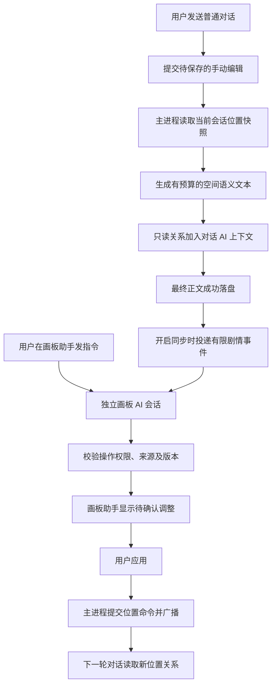

# 单聊空间画板与独立画板 AI 会话实施方案

> 日期：2026-09-30
>
> 状态：✅ 已完成 — 阶段 0、1a、1b、2、3、4 已实施，PC 单聊读取、独立画板 AI、确认及可选自动同步闭环完成；266 项回归、25 项浏览器操作及 97 项指定模型联验检查通过，见[阶段 4 报告](../../报告/空间画板单聊接入阶段4实施报告-2026-10-01.md)。按文档规则归档；群聊在通用方案中另行实施。
>
> 分支：`codex/spatial-board-chat-integration`
>
> 第一阶段范围：PC 单聊；后续再扩展群聊。
>
> 用户确定的架构：对话 AI 与画板 AI 沿用当前聊天的连接和模型，分别维护会话上下文与历史；对话 AI 对画板只读位置关系，画板调整由画板 AI 提案、主进程提交。
>
> 通用会话规则见[对话 AI 与功能 AI 会话隔离方案](对话AI与功能AI会话隔离方案-2026-09-30.md)。本文补充画板的初始化、命令与提交规则。
>
> 群聊差异已在通用方案 §13 展开：群聊会话共享 runtime/画板助手、发言与叙事模式分别投影、按生成/接力批次同步；本阶段不直接套用单聊回调接入群聊。

## 1. 要完成的体验

用户在画板上放置角色、设置区域和地点后，对话 AI 在下一次单聊读取位置关系并正常对话。用户要移动人物或调整地图时，在独立的“画板助手”会话中发指令，由画板 AI 给出调整建议，确认后更新。

例如：画板中 Aiko 位于「客厅」，大本位于「厨房」。对话 AI 读取两人位置；用户在画板助手说“把 Aiko 移到厨房”，画板 AI 提出移动，用户确认后提交。下一轮对话 AI 读取更新后的关系。若开启剧情同步，对话正文中的已完成移动也可作为事件交给画板 AI 评估，按需确认或自动策略处理。

第一版默认 **对话读取开启、画板 AI 指令需确认、剧情同步需确认**。读取开关、画板 AI 会话和剧情同步策略分别控制。关闭剧情同步不影响用户主动发画板指令；关闭对话读取不影响独立画板 AI 和手动编辑，自动剧情同步随之停止。

## 2. 实施前代码基线

以下记录阶段 0 开始前的情况。现阶段 0—4 已实施，手动编辑已经迁移到主进程命令提交，AI 初始化、独立助手、对话读取、确认及自动策略均接入同一权威入口。分阶段证据见 §13 及各实施报告。

| 能力 | 当前情况 | 本方案需要补齐 |
|---|---|---|
| 单聊绑定画板 | 已有入口、嵌入编辑器、会话绑定 | 保留现有入口，增加会话策略 |
| 首次空间初始化 | 创建根画板和“未参与对话”区域，登记当前角色与 persona；位置为空 | 增加设定/聊天生成草稿、起始位置确认与幂等创建 |
| 手动编辑保存 | iframe 发完整 world/runtime，父组件约 350ms 合并保存 | 改为主进程统一接收命令、校验版本并提交 |
| 世界与角色位置 | 世界共用；位置运行时按单聊会话保存 | 读取必须使用当前会话 runtime |
| 语义投影 | 已有 `projectCompactText` | 按单聊角色聚焦、裁剪、计入上下文预算 |
| 画板 AI 会话 | 当前没有；只有 JSON 剧情命令模拟面板 | 沿用聊天连接和模型，增加独立会话历史、用户指令与剧情同步任务 |
| 剧情命令 | 已有模拟解析、策略判断、纯核心命令执行 | 由画板 AI 提取，持久化建议并由主进程调度 |
| 未参与对话 | 画板已有系统区域标记 | 接入单聊参与规则 |
| 主题与头像 | 已由父应用传递，属于展示数据 | 保持与模型上下文、位置事务分离 |

实施前 `saveBound` 校验绑定和文档结构，并以文件锁串行写入，**没有比较提交者读取时的 runtime revision 与磁盘版本**。文件锁不能阻止较旧的完整快照覆盖较新的拖动或后台移动。阶段 0 已停用该写入入口，以命令提交替代。

依据当前实现，数据路径为：

```text
<userData>/data/spatial/worlds/{worldId}.json
<userData>/data/spatial/runtimes/{characterId}/{sessionId}.json
```

主要依据：[PC 空间 IPC](../../../electron/ipc/spatial.ts)、[初始世界工厂](../../../spatial-board/src/core/factory.ts)、[单聊画板面板](../../../src/components/chat/SpatialBoardPane.tsx)、[嵌入桥接](../../../spatial-board/src/embedded/bridge.ts)、[语义投影](../../../spatial-board/src/core/projection.ts)、[剧情策略](../../../spatial-board/src/story-adapter/policy.ts)。

本文承接[独立开发方案](../空间画板与剧情位置系统独立开发方案-2026-09-29.md)和[阶段 6 接入前评审](../空间画板-PC接入前评审-阶段6.md)。旧文档中“PC 尚未接入”的描述属于历史基线；后续单聊读取与回写按本文执行。

## 3. 空间初始化

### 3.1 首次入口与三种起步方式

首次点击单聊的“画板”，未绑定时在现有创建页面提供：

| 方式 | 创建内容 | 起始位置 |
|---|---|---|
| 从当前设定生成（推荐入口） | 角色卡、实际开场白与当前聊天中的区域/地点草稿，确认后创建 | 仅提出有来源依据的位置，由用户确认 |
| 创建空白 | 根画板、“未参与对话”系统区域、当前聊天角色与有效 persona | 两者默认未放置，用户可以直接拖入自建地点 |
| 绑定已有世界 | 复用区域、地点、层级与距离；按 externalRef 补齐必要 actor | 为本会话建立独立 runtime，默认未放置，不复制其他会话的位置 |

点击“从当前设定生成”才向画板 AI 会话发起初始化请求，不在打开聊天、打开画板或首次发送时静默调用。沿用当前聊天的连接和模型，以初始化专用提示和选定材料组装请求。生成失败可重试或创建空白；用户可以取消，不影响聊天和已有绑定。

只有首次未绑定时提供“创建并绑定”。已有绑定直接加载原 world/runtime，不重复生成。仅含系统默认结构、没有自建地点和角色位置的已有空白画板，可以显式执行“从当前设定生成”，以增量命令应用草稿；已包含用户地点或位置的画板不走首次初始化，第一版不提供整图重新生成。

### 3.2 初始化依据与优先级

输入由主进程读取已保存数据，展示本次来源摘要：

1. 用户在初始化界面明确填写的场景说明、起始位置。
2. 当前会话已保存、当前选中的最近对话正文，按时间识别最后明确的空间状态。
3. 当前会话实际使用的开场白；不能把未选中的 `alternateGreetings` 全部混入。
4. 角色卡 `scenario`、`description` 中的空间设定和本会话有效 persona。
5. 角色/会话绑定且启用的世界书中相关空间条目，可由用户展开勾选补充。

新会话依据选中的开场白建立起点；已聊过的会话优先采用最近明确位置，不能用开场白把角色放回起始地点。聊天中的回忆、计划、假设和未选中的候选回复不作为当前位置依据。示例对话只属于写法示例，默认不用于建图或定位。

角色卡和世界书可以说明一个地点存在，但“角色住在某处”不能证明此刻就在该处。同名地点、互相矛盾的层级或无法判断的当前位置保留为待核对项，不由模型随意选一个。世界书中的空间设定未必属于当前会话场景，来源不同且有冲突时由用户选择。

输入按项目现有 token 估算裁剪，建议上限 6,000 tokens，并受当前聊天连接和模型的实际上下文预算限制。保留用户场景说明、选中的开场白与最近位置证据，优先裁剪远处地点和长描述。被裁剪的来源在预览中说明；不导入全量历史、所有世界书、思考内容、头像或无关设置。

### 3.3 模型生成结构化草稿

画板 AI 按请求来源使用不同权限：初始化可以提出新世界草稿，用户主动的画板指令可以提出地图编辑，自动剧情同步只提出已存在角色的位置变化。权限模式由主进程指定，模型不能自行切换。初始化输出有来源的草稿，不直接提交核心命令、不决定正式 ID：

```text
draft
  worldName / description
  regions / places：draftKey、名称、类别、父级引用、来源
  childBoards：入口节点引用及子画板关系
  distances：端点引用、原文明确给出的距离、来源
  initialPlacements：本会话 actor 引用、目标地点、精度、来源
  unresolved：重名、层级或位置冲突，供用户核对
```

第一版限定最多 20 个区域/地点、4 张画板、20 条距离关系，只登记当前单聊角色和有效 persona；其余人物可写入场景描述，不自动创建可发言角色。初始化输出建议上限 4,096 tokens；超限、截断或结构无效则本次失败，保留输入供用户缩小范围后重试。

已有节点名可合并为候选，但不能仅凭相同名称合并不同父级的地点。地图层级必须有来源依据；描述只说“客厅旁有厨房”时不能推导出门、走廊、楼层或完整房屋布局。未说明的距离保持空缺。画布坐标、节点大小和排列由应用确定性布局生成，模型不猜测像素几何，也不把图上距离当作物理距离。

主进程校验草稿的引用、层级循环、类别、数量、距离单位及证据来源。正式世界、画板、节点和 actor ID 由应用分配；actor 通过现有角色/persona ID 映射。模型生成的 draftKey 只在草稿内解析，不能用于覆盖磁盘中的既有对象。

### 3.4 预览、起始位置与确认

生成完成后在当前画板区域显示草稿预览，旁边只放“创建并绑定 / 返回修改 / 取消”；已有空白画板的确认按钮为“应用初始场景”。用户可以删减地点、调整名称与层级，选择起始地点。每个模型提出的起始位置可展开查看来源；缺少依据时显示“未放置”，提供手动选择。

- 聊天角色和 persona 不默认放进“未参与对话”区域，否则首次建图就可能阻止代入聊天。
- 两者位置未知时也不默认放在同一地点，避免凭空假定在场关系。
- 用户明确选择“同处某地”可以一并放置；未选择 persona 或会话明确 `personaId=null` 时不强造一个用户 actor。只有 `personaId` 未设置时才采用有效默认 persona。
- 系统区域只按系统标签识别，不能因为角色未被近期正文提到就归为“未参与对话”。
- 起始位置通过核心 `place_actor` 生成，路径由核心重算；初始化记录归于 `source=system`，不能伪造为历史回复造成的剧情移动。

例如，当前正文只明确“Aiko 在客厅等你”，可以提出客厅及 Aiko 的初始位置；“等你”不能证明用户也在客厅。若用户想让两人从客厅开始，在预览中选择即可。

纯手动创建空白不要求填写地点，也不设置初始化完成门槛来阻止聊天。空白但有效的 runtime 是合法起点；未放置位置按后文的未知位置规则读取。

### 3.5 初始化事务与复用

新建并绑定时，主进程重新检查会话仍未绑定、来源选中正文未变、角色/persona 身份一致；若来源变化，保留草稿供用户刷新核对。用一个 `initializationId/commitId` 将世界、初始 runtime、初始化记录和会话绑定提交为一次可恢复事务，绑定在数据校验及写入成功后生效。

已有空白画板补初始场景时，核对原绑定、runtime revision 和 world fingerprint，并再次检查它仍是空白状态；只追加经确认的地点及起始位置，不替换世界、不重置 runtime、不覆盖名称。世界被其他会话共用时在预览明确显示共享关系，用户确认的是对共享地图的修改，角色位置仍只写当前会话。该操作作为新的初始化提交记录，保留之前的空白创建来源。

`session-state` 增加 `initialization` 记录，包含模式、来源引用与 fingerprint、创建时间、提交 ID。初始化完成后纳入既有备份；反复加载、双击确认或网络重试不重复创建世界、角色和地点。进程在创建途中退出时，根据事务记录恢复结果或清理本次未绑定的孤立数据，不能删除共享世界或替换已有位置。

绑定已有世界时只登记缺失 actor，并为本会话创建位置状态。若用户要根据当前聊天确定起点，单独生成“初始位置建议”，只能映射到已有地点；找不到地点时保持未放置，不能借此自动改动其他会话共用的地图。

已有有效 runtime 优先加载，不因 `placements=[]`、`revision=0` 或缺少新初始化记录而重新初始化。绑定指向的 runtime 文件缺失/损坏属于恢复问题，必须提示恢复或显式重建，不能悄悄从开场白重置。旧绑定缺少 `initialization` 字段时采用兼容读取，不覆盖数据。

初始化、绑定和用户切换 persona 时，可以执行明确的 actor 同步命令；对话投影和上下文预览必须使用无写入的读取方法，不能复用当前会补 actor、创建 runtime 的 `loadBound` 行为。新 persona 默认未放置，旧 persona 不从共享世界中删除，也不自动继承位置。

## 4. 两个独立 AI 会话及总体链路

### 4.1 会话与能力分离

| 项目 | 对话 AI 会话 | 画板 AI 会话 |
|---|---|---|
| 职责 | 角色对话、叙事，读取已确认位置关系 | 初始化空间、理解用户画板指令、评估剧情位置事件 |
| 身份 | 现有角色/旁白身份 | 固定为画板助手，不扮演聊天角色 |
| 历史 | 现有单聊 messages 与记忆 | 独立 `spatialAiSessionId`、指令历史、提案及实际提交结果 |
| 模型配置 | 现有聊天连接/模型 | 沿用同一聊天配置；下一次请求跟随聊天连接或模型的切换 |
| 画板输入 | 有预算的位置、包含关系、相对方位、已知距离和参与状态 | 本会话权威空间状态、目标索引、画板指令及必要来源 |
| 输出 | 普通聊天正文 | 助手说明与结构化调整提案，确认后由主进程执行 |
| 写入能力 | 没有画板工具或提交接口 | 可提出允许的操作；自身不能直接写文件或跳过校验 |

两个会话共用当前聊天的连接和模型，分别维护会话 ID、系统提示、消息历史、任务预算、取消操作、任务状态与统计。任务预算复用现有规划器，并受同一模型能力限制。实现时采用无状态 API 请求组装各自 messages，不共享供应商侧 conversation/thread ID；画板助手不增加连接或模型选择器。

当前聊天连接未配置或不可用时，画板 AI 请求提示检查现有聊天配置或重试，手动编辑和位置读取继续可用。对话 AI 的画板输入不含命令 schema、原始 JSON、内部提交 ID 或画板助手历史，也不要求它在正文后输出控制指令。

### 4.2 数据流



职责分配：

- **纯空间核心**：位置、层级、距离、命令执行和结构校验，不依赖 React 或 Electron。
- **主进程空间服务**：唯一写入入口，负责绑定、版本、读取投影、剧情任务、建议队列和事务记录。
- **聊天上下文构建器**：接收可选空间文本和预算元数据，参与现有上下文分配。
- **对话 AI**：理解只读位置关系并正常叙事。
- **画板 AI**：在独立会话中处理初始化、直接指令或有限剧情事件，输出对应权限的候选，不直接写文件。
- **渲染层与 iframe**：展示、提交编辑命令、确认建议、接收权威更新。

剧情同步开启时，主进程在正文落盘后向画板 AI 投递事件。只传本轮用户输入、最终正文和空间快照引用，作为带来源的事件载荷；不复制完整对话 messages、记忆、角色提示词或思考内容，不把主对话助手消息冒充画板 AI 的历史回复。该流程增加一次画板 AI 调用，单独记录耗时和用量。

### 4.3 画板 AI 历史与当前状态

每个 PC 单聊关联自己的画板 AI 会话，绑定范围是 `characterId + sessionId + worldId + runtimeId`。共用 world 的单聊不共用画板 AI 历史。未绑定时可建立临时范围用于初始化，确认绑定后写入范围；解绑或更换世界时归档旧范围并建立新会话。

在 `ChatSession` 增加可选 `spatialAiSessionId`。画板 AI 的范围信息、消息、提案引用和历史摘要保存为独立 JSON：

```text
<userData>/data/spatial/ai-sessions/{spatialAiSessionId}.json
```

画板 AI 会话不保存独立的 `profileId/model` 覆盖项。每个请求开始时，通过聊天共用的解析入口取得当前有效连接和模型；运行中的请求及其内部重试使用同一快照，后续新请求跟随聊天配置。请求记录可保存实际使用的连接标识与模型名用于统计，不保存密钥或完整连接配置。历史消息区分用户画板指令、初始化请求、剧情同步事件、AI 提案和主进程实际提交结果。正文聊天的导出、记忆摘要、候选回复和 token 统计不混入这份历史，反向也不混入普通聊天。

每次画板 AI 请求都从服务读取最新权威快照；历史只用于理解连续指令，例如“把她再移回去”，不能当作当前地图的唯一来源。代词不能唯一定位时先询问，不生成可执行移动。待确认提案只说“建议移动”，收到成功提交结果后才记录“已移动”。

画板 AI 自身的历史可独立摘要与裁剪，保留当前未解决指令、有效提案、近期已确认操作和指令指代所需信息；原始空间状态不靠模型摘要恢复。初始化与助手历史纳入备份、会话删除和恢复验证。

## 5. 发送前如何读取

### 5.1 一次请求只使用一个快照

1. 根据 `characterId + sessionId` 读取会话绑定及开关；只对 PC 单聊启用。
2. 如果画板打开且存在待提交命令，先等待该会话提交完成。保存失败则保留输入稿并提示重试，不能声称读取了刚刚拖动的位置。
3. 主进程在一致读取边界内加载 world/runtime，解析当前聊天角色与当前 persona 的 `externalRef`。
4. 生成空间文本，同时返回 `worldId`、`runtimeId`、`runtimeRevision`、`worldFingerprint` 和本轮快照标识。
5. 将这份文本交给上下文构建器；正文完成后的提取任务使用同一份快照和标识。

画板关闭时仍可读取磁盘上的绑定数据。没有绑定时不加入空间字段、不发起提取请求；旧会话的上下文保持原行为。绑定数据损坏或丢失时给出可操作的发送错误，用户可修复绑定或明确关闭读取后继续，避免静默使用陈旧缓存。

发送后用户仍可拖动画板。该轮回复使用发送时的快照；回写时发现版本变化则转为冲突建议，不覆盖新位置。

### 5.2 读哪些内容

对话 AI 的空间输入优先保留当前聊天角色和当前 persona 的位置、参与状态、容纳路径、相对方位及位置精度。再加入当前场景相关角色、所在区域的父层级、相关地点和用户设置的距离。地点名称用于表达关系；地点描述只保留解释位置所必需的内容，不注入地图编辑要求、操作建议或画板 AI 历史。

以下内容不进入主回复上下文：头像、主题、选中对象、缩放、滚动位置、完整事件日志、完整 world/runtime JSON。画布像素坐标用于排版，不能换算成世界距离；只有已定义的语义距离可用于叙事。

当前 `projectCompactText` 默认按 actorId 排序选第一个角色聚焦，且未限制所有角色位置条目的总量。PC 接入必须显式按当前聊天角色聚焦，并在投影前做会话相关性筛选，不能沿用默认焦点或仅截断输出字符串。

建议主对话投影形式如下。同名地点用完整路径区分，内部对象 ID 保留在服务快照与画板 AI 的目标索引中：

```text
[当前空间状态]
世界：新世界
角色 Aiko：住宅 > 客厅，参与对话，是
用户 大本：住宅 > 厨房，位置精度，区域内
相关地点：住宅 > 客厅、住宅 > 厨房
距离：客厅与厨房，用户未设置
约束：本块是当前位置事实；不把计划、假设或回忆视为已完成移动。
```

区域名称和描述作为数据处理，不能把描述里的指令提升为系统规则。未知位置明确写“未放置 / 位置未知”；没有距离明确写“未设置”，不能补造。

### 5.3 上下文接入与预算

在 `ContextBuildData` 增加可选 `spatialContext`，只携带文本、快照身份和 token 统计等轻量信息。`shared` 不引入空间编辑器 store、Electron API 或完整空间模型。

空间内容以 `current-state` 候选、`origin=spatial` 接入统一分配流程：位置事实用于当前场景判断；系统协议和角色身份继续按原规则处理，空间快照不重写角色卡。与历史或世界书中的旧位置冲突时，提示当前空间块是发送时已确认的位置基线。用户本轮明确声明的已完成位置变化可推进本轮叙事，但落盘仍按回写策略确认，不能把“准备去”解释为已经到达。

建议空间文本硬上限 **800 tokens**，使用项目现有 token 估算，并纳入主请求的输入预算、诊断与裁剪报告。先裁剪长描述、远处角色、额外距离，再裁剪次要地点；当前聊天角色、persona 的位置与参与状态不能被静默丢弃。最小必需块仍无法容纳时，发送前提示预算不足。

接入必须发生在历史与世界书预算分配之前，不能在预算完成后额外拼接。上下文预览使用相同投影与分配规则，展示“空间状态已读取、位置版本、占用 tokens”，预览自身不创建 runtime 或写入数据。

### 5.4 未参与对话与未放置

| 情况 | 单聊行为 |
|---|---|
| 未放置 | 允许发送；位置记为未知，不等价于未参与对话 |
| 代入模式下，聊天角色明确处于“未参与对话”区域 | 发送前提示“该角色未参与对话”，保留输入稿，提供打开画板操作 |
| 全局模式下，角色处于该区域 | 允许旁白继续；不将该角色作为当前现场的对话参与者 |
| 世界中的其他角色位于别处 | 可提供相关位置事实；不能因为出现在世界文档中就成为本次单聊发言者 |

模型不能擅自把角色移出“未参与对话”区域恢复参与。用户需要手动放置，或明确确认相应位置建议。persona 的移动还必须有本轮用户明确完成的行动或用户确认；AI 不能替用户决定主要行动。

### 5.5 场景、参与和可见信息

“同场景”按最具体的已知锚点和完整包含路径判断。两人同属一栋住宅、一个区域或一张画板，只说明同域；分属客厅和厨房时不能默认面对面。同锚点且没有更细位置时可描述同处该地点，但不能推导距离、视线、隔音或接触关系。

位置不同本身不阻止单聊，也不等于未参与对话。聊天可以承接已明确的电话、消息等异地交流；未交代交流方式时保持距离和视角约束，不能凭空写出两人面对面或互相触碰。“未参与对话”系统标记才按 §5.4 处理。

空间事实不等于角色知识。第一版代入投影默认只包含当前聊天角色和 persona 的位置，persona 的异地位置标注为引擎背景状态，只有对话已有明确依据时才作为聊天角色已知信息；其他 actor 的位置不加入代入主回复。全局模式可以提供相关异地状态，但旁白知道不代表角色知道。第一版只允许提取当前聊天角色与当前有效 persona 的位置变化，世界中的其他 actor 保持只读。

第一版不建立新权限模型。服务显式区分主回复的场景投影与提取器使用的目标索引；投影不能把 world 中所有角色的私有描述一起发送给代入角色。需要额外可见性标签、战争迷雾或秘密地点时另行扩展空间模型。

### 5.6 待确认建议与下一轮

待确认移动不会阻塞发送。界面可就地提示“画板助手有未应用的位置建议，继续发送将使用画板位置”，提供“应用并发送”；正常发送按已落盘位置构建上下文。只提示涉及当前聊天角色或 persona 的有效建议，不增加确认弹窗。提示和确认由 UI 与空间服务处理，不向对话 AI 注入画板操作流程。

后续空间投影只说明“以下是本轮已确认的位置基线”；未应用的剧情不能从旧正文再次推定为画板事实。对话 AI 不接收提案文本、确认按钮或操作队列，该基线说明属于 800 tokens 预算。“应用并发送”先等待位置事务成功，再读取新快照；事务失败则保留输入稿，不发送。

用户本轮输入如“我现在在厨房”属于新的已完成位置声明，本轮叙事可采纳；保存成功后提取为 persona 待确认建议。普通发送不会直接改文件，AI 对用户位置的相反描述也不能覆盖用户声明。位置信息来源、叙事采用状态与画板已确认状态必须在诊断中区分。

## 6. 画板 AI 指令与剧情同步

### 6.1 用户主动的画板指令

用户在画板助手输入“把 Aiko 移到厨房”“在住宅下新建卧室”“把客厅改名为起居室”等命令，由画板 AI 在自身会话中解析。主进程以 `board_instruction` 标注来源并分配用户指令 ID，不能让模型声明自己属于哪个权限模式。

第一版可提出人物放置/移动、区域和地点创建、改名/描述/层级调整，以及已有距离的设置；删除地图结构必须符合全部 runtime 的引用保护并明确展示影响。角色身份和 externalRef 由应用管理，指令不能凭空增加或替换聊天角色。新实体先使用草稿引用，正式 ID 与几何布局仍由服务分配。

直接指令是用户要求的位置/地图设置，不需要伪装成“剧情已经发生”；`completed` 与正文证据要求只用于 `dialogue_sync`。两类提案第一版均需用户确认，主进程按绑定、来源指令、最新快照和操作白名单校验，确认提交后反馈实际结果。

主动画板指令在调用模型前先持久化到画板 AI 历史并登记任务，来源核对使用这条画板消息的 ID/hash。确认后的核心事件记为 `source=user`，剧情同步记为 `source=story`，初始化记为 `source=system`；画板 AI 会话、指令和提案关联保存在 PC 侧记录中，不改变核心 source 枚举。

查询位置只返回助手说明，不生成修改命令。不能唯一定位人物、目标或“她/那里/原来的地方”时先澄清。用户在普通对话输入的句子保留其聊天语义，不被对话 AI 转换成画板操作调用；主动控制在独立画板助手入口完成。

### 6.2 剧情同步的提取时机

只在最终正文成功保存、剧情同步开启且已关联画板 AI 会话时建立 `dialogue_sync` 后台任务，投递到本会话绑定的画板 AI；调用前检查当前聊天连接是否可用。任务不等待渲染层继续停留在聊天页，不阻塞正文完成，也不因提取失败把已保存的聊天改成失败。对话 AI 没有画板调用权限，也不负责填写控制 JSON。

提取输入包含：发送时的空间快照、当前用户输入、已保存的最终正文、生成类型和允许移动的 actor/目标清单。只使用正文，不读取模型思考内容；不再次发送完整聊天历史。

目标清单不受主回复 800 tokens 投影范围限制。服务依据正文提到的地点名，从发送时的完整世界快照检索候选，提供 ID 与完整路径，独立索引预算建议上限 2,000 tokens。没有命中或匹配不唯一时返回未解析目标，不能把“未展示给主模型”误判成“地图不存在”。提取总输入仍需核对连接预算；正文无法完整容纳时停止提取并提示，不能静默丢掉末尾移动。

沿用请求开始时当前聊天的连接和模型，使用画板 AI 的独立系统提示及任务上下文预算。剧情同步输出建议上限 1,024 tokens，已解析与未解析候选合计最多 16 个。模型支持时设低温度，支持 JSON 输出时启用约束；不支持时仍做严格 JSON 解析。超时、空响应、截断或解析失败时标记任务失败，在画板助手提供“重新提取”，不自动连续重试。剧情同步设为 `off` 时不产生这次调用，主动画板指令仍可使用。

建议初始化请求超时 90 秒、剧情同步超时 30 秒、主动画板指令超时 60 秒，作为集中配置的初始值。每个画板 AI 会话最多一个运行任务，用户主动指令优先于尚未开始的剧情同步。绑定身份、persona 和模式在任务创建时冻结，当前聊天的连接/模型在实际请求开始时冻结；排队任务发出前重新核对范围和连接可用性。切换聊天配置不自动取消、重配或重试已发出的请求，下一次新请求使用更新后的聊天配置。

### 6.3 剧情同步只返回候选

建议提取协议如下，示例 ID 仅用于说明：

```json
{
  "schemaVersion": 1,
  "changes": [
    {
      "actorId": "actor-a",
      "boardId": "board-home",
      "targetNodeId": "place-kitchen",
      "semanticPosition": {
        "precision": "inside-only",
        "note": "门边"
      },
      "completed": true,
      "confidence": 0.95,
      "evidence": "Aiko 走进厨房，在门边停下",
      "evidenceSource": "assistant"
    }
  ],
  "unresolved": []
}
```

没有移动返回 `changes: []`、`unresolved: []`，属于成功结果。一个角色经过多个地方时只提出本轮结束时明确所在的位置。同名地点必须通过 ID 唯一定位；证据摘录须能在声明的用户输入或正文中找到。

“在厨房”“进入住宅”等只确定节点内部的动作，精度使用 `inside-only`；“门边”等更细说明可写入有证据的 note，不凭空新建门节点。相对方向只能引用同画板已有节点，缺乏依据时不填。模型不提交像素坐标，显示位置由应用布局分配；目标与当前语义位置完全一致时过滤为空操作，避免反复增加 revision 和事件。

`unresolved` 保存 actor、目标原文、已完成证据及缺失/歧义原因；这部分不转换为核心命令。位置状态只表示本轮结束时的地点与已知精度，第一版不自动推演行进路线、耗时、速度或碰撞。

`requestId`、`messageId`、正文 hash、会话绑定和版本由主进程补充，不接受模型指定。`completed`、`confidence` 和证据必须显式提供，不能沿用模拟器缺省“已完成、高置信”的行为。置信度只是筛选信号，不能替代证据或版本校验。

### 6.4 剧情同步候选校验

按以下顺序判断，任一不满足则不能写入：

1. JSON 结构、长度与枚举合法；批次候选数不超限。
2. 来源消息仍存在，其当前选中正文 hash 与任务来源相符；生成已完整结束；该建议未被更晚完成的回复取代。
3. 会话仍绑定同一世界和运行时，persona 与叙事模式身份相符，读取/回写策略仍允许本操作。
4. actor 在本轮允许集合中；目标 board/node 存在且关系匹配。
5. 动作是已完成事件。“准备去”“如果去了”“想起以前去过”不构成移动。
6. persona 的完成动作有用户输入依据；仅有 AI 替用户作出的行动描述不能作为自动移动依据。
7. 发送快照的 runtime revision 和世界 fingerprint 与当前版本相符；存在变化则标记待重新核对。
8. 同一角色的最终目标唯一；将候选转换为核心命令后通过整批校验。

`dialogue_sync` 只生成 `place_actor` 和 `move_actor`。不能通过 `remove_actor_from_board` 表达“离开现场”，因为移除会变成位置未知；离开需要有已定义的目标位置。剧情同步不创建区域、地点、距离或角色，不修改几何、名字和地图结构；仅明确的 `board_instruction` 或初始化请求可以提出对应范围的地图调整。

未解析目标在画板助手显示“选择已有地点 / 创建地点”。用户可手动创建，或向画板 AI 明确发送创建指令；该指令单独预览确认。之后服务重新核对原移动来源、actor 与版本，展示实际目标路径，确认后提交新的移动命令；不能仅替换旧候选 ID 就跳过校验。用户忽略时记录原因，同一来源不反复提出相同建议。

### 6.5 剧情同步三种策略

| 策略 | 处理 |
|---|---|
| `off` | 不投递剧情事件；仍允许主动画板 AI 指令与手动编辑 |
| `suggest`（默认） | 合法已完成动作生成待确认建议；用户应用后才写入 |
| `auto`（阶段 4 已实施） | 普通新回复中，证据充分、版本一致且置信度至少 0.9 的非 persona 移动可自动应用；其他候选仍需确认 |

阶段 0—3 默认只开放需确认；阶段 4 在指定真实模型联验通过后新增可选 `auto`，默认仍为 `suggest`。计划、假设、回忆和歧义目标显示诊断原因，不用一个“应用”按钮将其变成已经发生的事实。版本冲突则显示当前位置与建议目标，用户重新核对后可按最新版本提交。

自动采用整批资格规则：所有命令均须为当前角色的已完成移动，不能含 persona、未知目标、低置信度或重新核对候选。发送时冻结策略及开关代次，提交时再次核对；开启自动不会批准旧建议，开关关开也不会追认在途建议。重启遇到尚未完成的自动决定转为手动确认，不再次自动尝试。已提交结果保留事务收据并可撤销。同地点的说明文字变化不构成剧情移动。

一次建议批次整批成功或整批失败，避免部分角色已经移动、其余未移动却显示整体成功。

## 7. 统一写入与冲突处理

### 7.1 主进程成为提交方

把现有 IPC 中的存储逻辑整理为 `spatialRepository`，再建立 `spatialService`，供 IPC、上下文和聊天调度共同调用。主进程复用纯核心的命令执行和校验，不依赖渲染层 Zustand。

每次提交必须包含：`commitId`、绑定身份、`expectedRuntimeRevision`、`expectedWorldFingerprint` 和命令批次。服务在同一锁内重新读取磁盘、检查版本、运行批次、校验结果并持久化。相同 `commitId` 重复请求返回原结果，不再次执行。

世界 fingerprint 由稳定序列化的有效世界数据计算，包含节点层级、影响位置判断的几何、参与标签及距离等；排除头像 URL、视口和纯时间戳。仅检查 runtime revision 不够：同一世界可被其他会话修改。

共享世界的结构修改必须检查所有绑定会话的 runtime。第一版删除、跨画板移动、重挂父级或移除入口时，只要目标或子树仍被任何 runtime 引用，就拒绝该操作并列出受影响会话，先由用户调整位置。不能只验证当前会话，也不能通过 cascade 把其他会话人物悄悄变成未放置。改名不改变 ID；地图排版调整不等于角色的剧情移动。

手动拖动提交为用户设置的当前位置，下一轮以此为基线；旧回复保留原文，不重写历史。用户只是查看、缩放或调整节点排版时，不产生角色移动建议或人物知识变化。

### 7.2 嵌入编辑器迁移

iframe 从“发送完整快照保存”改为“发送核心命令批次”。本地可立即预览操作，但区分已确认状态与未确认命令；父组件收到主进程确认后更新基线。

收到外部更新时保留当前视口和选中对象。没有本地待提交命令时替换权威数据；有待提交命令时暂停提交、保留用户操作，并提示核对冲突。不盲目覆盖、不把旧完整文档重新保存。

权威数据更新需要专门的同步方法，不能每次走会重置历史或触发布局整理的导入流程。头像、主题和导航变化继续走展示通道，不触发位置事务。布局整理也不得被混入模型允许的命令批次。

### 7.3 确认与撤销

用户点击“应用”时再次检查来源、绑定、目标与最新版本；按钮展示了过时位置时要求先刷新并核对，不能直接把 `expectedRevision` 改成最新值绕过冲突。

剧情更新记录为独立事务，保留来源消息、应用前后位置及逆向命令。撤销同样经过主进程版本检查；后续已发生拖动时不回放旧快照，可以提示无法直接撤销并打开当前画板。

## 8. 建议、任务与重启恢复

在 `ChatSession` 增加可选字段 `spatialContextEnabled`、`spatialNarrativeSyncPolicy`、`spatialAiSessionId`。绑定会话的读取/同步策略缺省值分别是 `true`、`suggest`；画板 AI 会话按范围关联，连接和模型沿用现有聊天配置。开关以会话为唯一来源，不能与 iframe 内存各存一份互相覆盖，也不新增画板 AI 的连接配置字段。

world/runtime 先保留 v1 格式。PC 在以下新增文件持久化提取任务、建议状态和提交记录：

```text
<userData>/data/spatial/session-state/{characterId}/{sessionId}.json
```

记录至少包含 schemaVersion、初始化记录、来源消息与正文 hash、请求身份、会话生成序号、绑定身份代次、发送快照版本、候选证据、建议状态、提交 ID、失败原因及应用前后位置。提取去重使用会话、来源消息、正文 hash、生成身份；应用去重使用 commitId，不能仅依赖消息 ID。绑定、persona 或叙事模式改变时递增身份代次并取消旧任务；解绑后重新绑定同一世界也不能复活旧任务。

普通回复保存成功后，先登记可恢复的待处理任务，再进入后台队列。主进程重启后对照已保存正文与检查点核对最新一轮遗漏任务；重复登记通过去重键合并，不扫描全部历史来批量调用模型。尚未发出请求的最新任务可以恢复；已发出但结果未记录的请求标为中断，供用户重试，避免重启后重复计费。提取失败允许用户重试，不能把失败状态伪装成“无移动”。

任务使用独立状态 `queued / running / succeeded / failed / cancelled / superseded`；建议使用 `pending / accepted / rejected / stale / failed`。每条记录显式区分 `initialization / board_instruction / dialogue_sync`，并记录画板 AI 会话 ID。剧情同步按主对话生成顺序失效；主动指令按画板会话自身的指令顺序校验，不能因为普通对话新增一条回复就让用户主动的编辑指令失效。两类来源都需要当前绑定和版本校验；同 actor 的较新主动指令使较旧冲突移动失效。

剧情同步建议只保留最新有效主对话来源；主动画板指令的有效提案独立保留，按目标冲突及指令顺序更新。runtime 核心事件目前最多保留 500 条，幂等完成标记不能依赖这份可裁剪日志：commit 标记按对应来源消息/会话生命周期保留，详细诊断只保留最近 100 次任务，清理时保留当前建议、已应用事务及重启恢复所需字段。消息清理不得复活已处理任务。

持久化只保存连接标识、模型名及必要的来源引用，不写 API key 或完整连接配置。对话正文与画板 AI 用量分别统计，画板 AI 内再区分初始化、主动指令和剧情同步；提取无移动也计入实际辅助请求用量。画板 AI 取消/失败不改变主对话终态，主对话取消不取消已提交的独立画板指令，手动编辑继续可用。

runtime 与 session-state 分文件写入时必须有事务日志：先记录准备提交的批次及前后指纹，再原子替换 runtime，最后完成提交记录。重启后检查实际 runtime 与前后指纹，恢复已完成提交状态或保留失败待处理；遇到不匹配数据不能再次盲目执行。客户端只有在事务完成后收到成功确认。

现有备份会收集 spatial 下的 JSON，新增文件仍需验证备份、恢复和事务恢复的顺序。删除会话清理其 runtime、session-state 和关联的画板 AI 会话（包括已归档范围），不删除可能被其他会话使用的 world；恢复时校验 AI 会话归属和绑定范围，识别孤立引用和缺失世界，不能把另一个会话的位置或助手历史接过来。

## 9. 对话生命周期规则

| 场景 | 处理规则 |
|---|---|
| 正常新回复 | 保存完整正文后提取，默认待确认 |
| 用户在画板助手发指令 | 使用独立输入与历史，沿用聊天连接和模型；确认调整后主对话下一轮只读取结果 |
| 重生成 / 切换候选回复 | 只为当前选中的正文保留有效建议；始终需确认，不自动回放位置 |
| 续写 | 按保存后的完整正文与新正文 hash 处理，已有完成动作不重复应用；始终需确认 |
| 请求重试 | 相同生成身份或相同来源结果去重；新的完成正文重新评估 |
| 停止、超时、空正文、截断或保存失败 | 不提取、不写位置；部分输出不能当作已完成剧情 |
| 修改 / 删除来源消息 | 未应用建议失效；已应用事务标记来源已变化，不自动回退后续位置 |
| 提取期间用户拖动 | 建议标记版本冲突，展示最新位置后重新确认 |
| 提取期间切换会话 | 任务继续归原会话；不得写到当前打开的会话 |
| 新回复完成后旧提取结果才到达 | 按生成序号标记 superseded，不应用旧结果 |
| 有建议未确认就继续发送 | 使用已确认画板位置，提示未应用状态；可点“应用并发送” |
| 更换 persona | 后续发送重新解析用户 actor；旧任务不能移动新的 persona |
| 关闭剧情同步 | 停止未应用的剧情任务；主动画板 AI 指令继续可用 |
| 解绑 / 更换世界 | 取消所有旧范围任务并归档画板 AI 会话，建立新范围后不复活旧任务 |
| 切换对话模型 / 取消主生成 | 已发出的画板请求使用原快照，新请求跟随聊天配置；取消的正文不投递剧情事件，独立画板指令保持自己的状态 |
| 多个会话共用一个 world | 共用地图，位置各自独立；世界结构修改使相关旧建议重新校验 |
| 重启 / 重复点击应用 | 待确认建议可恢复；已完成 commit 返回已有结果 |
| 新建 / 导入聊天记录 | 默认未绑定，旧绑定 ID 不直接继承；需要重新选择世界与起点 |
| 后续增加“复制当前会话空间”入口 | 复用 world；为新会话创建新 runtime/提交身份，不复制待确认队列或运行中的任务 |

第一版不实现“切换历史回复就倒带整个世界”。若某条已应用剧情被改写，界面提供来源变化提示和受版本检查的撤销操作，不覆盖此后手动编辑。

重新初始化或更换绑定作为单独的用户操作，先停止当前会话任务，再更新身份代次，最后提交新绑定。第一版不新增聊天分支或复制入口，若后续提供应遵循表中隔离规则；第一版也不提供按某条历史消息完整倒带位置的入口。聊天记录的普通导出不等于空间备份，完整空间恢复沿用应用备份。

## 10. 两条聊天链路的接入点

### 10.1 ChatTask V2

- 在[主进程上下文数据源](../../../electron/context/mainContextProvider.ts)中读取空间数据，经[上下文服务](../../../electron/chat/contextService.ts)传递快照身份。
- 在[统一上下文构建器](../../../shared/chat-core/contextBuilder.ts)中加入空间候选和预算；扩展[上下文输入契约](../../../shared/contextTypes.ts)。
- 在[聊天编排器](../../../electron/chat/orchestrator.ts)的正文提交成功点登记空间后台任务，方式与现有辅助调度职责一致。
- 单独的 `spatialAiScheduler` 向画板 AI 会话投递事件并负责恢复；主对话不会获得地图工具，渲染层通知只刷新显示，不再触发第二次同步。
- 目前共用主进程上下文的桥接/Android 调用必须按客户端来源过滤。本阶段只对 desktop 单聊启用，不能因增加共享字段而顺带改变其他端。

### 10.2 Legacy 兼容链路

- 在[流控制器](../../../src/store/streamController.ts)的预取阶段请求空间投影，再交给[渲染层数据源](../../../src/context/rendererContextProvider.ts)和同步上下文构建。
- 缓存属于一次请求，以会话和快照身份隔离；切换会话清除。同步 `syncBuildData` 本身不做 IPC。
- 在[聊天 store](../../../src/store/useChatStore.ts)完成回调中，先等待最终消息保存成功，再通知同一个主进程空间调度服务。当前不等待保存的调用方式需要调整。
- 失败重试若复用 `prebuilt` 上下文，必须同时保留对应空间快照；重新构建时必须重新读取，不能把旧快照身份配上新文本。
- [上下文预览](../../../src/store/chatContext.ts)复用读取结果，保持无写入副作用。

两条链路最终汇合到同一调度器和去重记录。不能同时在 V2 主进程完成点、渲染层通知和 legacy 回调各执行一次位置提取。

## 11. 接口与文件调整清单

以下是计划接口名称，实施时按项目现有类型和命名约定落地。

| 位置 | 调整 |
|---|---|
| `electron/services/spatialRepository.ts`（新增） | 一致读取、初始化事务、命令提交、版本校验、提交去重与事务恢复 |
| `electron/services/spatialService.ts`（新增） | 初始化来源收集、草稿生成与校验、会话规则、投影、建议确认与来源校验 |
| `electron/services/spatialAiSessions.ts`（新增） | 独立画板 AI 会话范围、历史、摘要与归档；请求复用聊天连接/模型解析 |
| `electron/services/spatialAiService.ts`（新增） | 独立提示/请求组装、初始化与用户指令、剧情事件解析和权限分类 |
| `electron/services/spatialAiScheduler.ts`（新增） | 画板会话串行队列、直接指令优先、来源失效及重启恢复 |
| `electron/ipc/spatial.ts` | 复用服务；增加 `prepareInitialization`、`commitInitialization`、`projectContext`、`applyEditorBatch`、`listSuggestions`、`resolveSuggestion`、`setPolicy`、`unbind` 与更新广播 |
| `electron/ipc/chat.ts`、`electron/services/backup.ts` | 新会话字段允许列表、删除时的 AI 会话清理、AI 历史与绑定的备份恢复 |
| `electron/preload.ts`、`shared/ipc-api.ts` | 增加画板 AI 的 getSession/sendInstruction/cancel/readHistory 与有类型事件；不暴露任意文件写入或模型自选权限 |
| `shared/types.ts`、`shared/contextTypes.ts` | 画板 AI 会话关联、读取/同步开关、只读位置文本与快照元数据 |
| `shared/chat-core/contextBuilder.ts`、`contextCandidates.ts` | 空间当前状态候选、预算、裁剪及诊断来源 |
| `electron/chat/contextService.ts`、`orchestrator.ts`、`ipc/chatTasks.ts` | V2 准备快照和完成后调度；注入空间服务依赖 |
| `src/store/streamController.ts`、`useChatStore.ts`、`src/context/rendererContextProvider.ts` | legacy 预取、保存后调度与请求快照管理 |
| `SpatialBoardPane.tsx`、`spatial-board/src/embedded/bridge.ts`、`spatialStore.ts` | 初始化入口与草稿预览、命令桥接、提交确认、外部同步和冲突展示 |
| `spatial-board/src/core/projection.ts`、`story-adapter/` | 会话聚焦投影、严格候选转命令；保留独立应用的模拟入口 |
| 画板助手面板、聊天消息组件与现有菜单 | 独立助手历史和输入、精简状态及来源跳转；沿用聊天模型 |

主进程内部直接调用服务，不通过绕一圈 IPC 处理自己的请求。来自 legacy 的完成通知要回读已保存消息核对，不能信任调用方传来的正文或绑定身份。

## 12. 界面保持精简

不增加新的整行工具栏。继续使用现有“画板”入口，菜单中放“对话读取位置”和“剧情同步：关闭 / 需确认 / 自动”。画板内的 ✧ 入口打开精简的“画板助手”侧栏，显示独立历史和输入框；需要说明模型来源时显示“使用当前聊天模型”，不增加模型选择器。

初始化复用当前未绑定页面，突出“从当前设定生成”，保留“创建空白”和已有世界列表；来源选择与冲突说明按需展开。生成后直接在画板区域预览，不增加多步全屏向导。

指令与详细提案显示在画板助手中，例如：`Aiko：客厅 → 厨房  [应用] [忽略]`。多角色建议合并成可展开的一条摘要。主聊天的来源消息旁最多显示“画板助手有位置建议”及查看入口，不显示画板 AI 聊天气泡、原始 JSON 或连接配置。失败与冲突在助手内处理，完整证据按需展开。

画板内通过现有面板显示当前会话待确认建议，点击可定位目标。应用后显示简短结果和“撤销”，不用常驻顶部状态条。PC 嵌入模式不展示给用户手工输入 JSON 的模拟面板。

## 13. 分阶段实施

| 阶段 | 交付 | 完成条件 |
|---|---|---|
| 0：统一提交 ✅ 已完成 | 主进程命令服务、编辑器迁移、版本冲突与事务恢复；[实施报告](../../报告/空间画板单聊接入阶段0实施报告-2026-09-30.md) | 旧快照不能覆盖新状态；手动编辑和撤销可用；重复提交只执行一次 |
| 1a：画板 AI 与初始化 ✅ 已实施 | 沿用聊天连接/模型，独立会话历史、用户指令、三种起步方式、草稿确认、幂等创建；[报告](../../报告/空间画板单聊接入阶段1实施报告-2026-10-01.md) | 自动回归及指定模型的初始化、移动和澄清补验通过 |
| 1b：对话读取 ✅ 已实施 | V2 与 legacy 的快照、投影、预算、参与规则、开关；[报告](../../报告/空间画板单聊接入阶段1实施报告-2026-10-01.md) | 实际请求含位置、关闭/未绑定回归原行为及 PC/Android 分流；指定模型能够读取确认后的新位置 |
| 2：剧情同步 ✅ 已实施 | 主正文保存后投递事件到画板 AI、严格解析、来源校验、持久化队列与建议；[报告](../../报告/空间画板单聊接入阶段2实施报告-2026-10-01.md) | 自动回归及指定模型的受控正文提取补验通过；对话 AI 只读，画板 AI 独立提取且需确认；计划、用户代行、未知目标和部分回复不写位置 |
| 3：确认闭环 ✅ 已实施 | 助手应用 / 忽略、主聊天简短入口与应用并发送、未知目标核对、独立地点创建、版本重核对、剧情撤销及 ZIP 恢复；[报告](../../报告/空间画板单聊接入阶段3实施报告-2026-10-01.md) | 用户确认后位置更新，下一轮读取新状态；自动回归、19 项浏览器操作与 49 项指定模型联验通过；两份历史不串写、不重复 |
| 4：自动策略 ✅ 已完成 | 非 persona 普通回复的可选 `auto`、整批资格、冻结开关、事务结果、撤销与恢复；[报告](../../报告/空间画板单聊接入阶段4实施报告-2026-10-01.md) | 指定模型联验后开放；仍可立即切回需确认或关闭；266 项回归、25 项浏览器及 97 项联验检查通过 |

阶段 0 是初始化事务和后台写入的前置条件。阶段 1a 完成空间起点，阶段 1b 验证对话读取；第一版对用户交付的闭环应至少完成阶段 0—3（包含 1a、1b）。阶段 4 独立收口。群聊按通用会话方案 §13 的作用域、参与者、共享 runtime 和批次规则另行接入、验收，不能复用单聊的一条回复一次同步而重复调用。

## 14. 验收标准

| 场景 | 必须观察到的结果 |
|---|---|
| 创建空白 / 无空间设定 | 仅有默认系统结构；当前角色与 persona 未放置，聊天可继续 |
| 对话 AI 与画板 AI 请求 | 同一聊天配置下使用相同连接与模型，各自组装 messages，历史与供应商会话 ID 不混用 |
| 切换聊天连接 / 模型 | 已运行请求保持配置快照，下一次新请求跟随聊天配置；两个会话历史保持分离 |
| 取消聊天 / 画板 AI 失败 | 各自任务状态独立，读取与手动编辑可继续 |
| 主对话模型实际请求 | 只有位置关系投影，没有地图工具、命令 JSON、画板助手历史或编辑指令模板 |
| 画板助手主动创建 / 移动 / 连续指代 | 确认后由主进程提交；指代不唯一先澄清；对话下一轮读取结果 |
| 关闭剧情同步后主动发画板指令 | 用户指令正常处理，不产生剧情事件调用 |
| 剧情正文提出新地点 / 越权改图 | 剧情模式只产生位置建议；地图创建需要用户在画板助手明确发指令 |
| 普通聊天回复更新期间有主动画板提案 | 不按主对话生成序号误作废主动指令，仍核对空间版本 |
| 新会话有多个备选开场白 | 仅采用实际选择的开场白，不把互斥场景同时建入 |
| 已聊过的会话初始化 | 最近明确的位置优先，不按开场白退回起点 |
| 初始化缺少用户位置 | persona 保持未放置，不因“角色等你”推定用户在场 |
| 地点重名 / 来源矛盾 / 输入裁剪 | 展示待核对项和缺失来源；不能猜层级或补造距离 |
| 初始化预览修改 / 取消 / 模型失败 | 正式地图与绑定未变，允许修改、重试或空白创建 |
| 双击确认 / 创建中途退出 | 初始化 commit 只生效一次；事务恢复不产生重复世界或孤立绑定 |
| 再次打开 / 旧 runtime 为空 / 文件丢失 | 有效空状态不被重置；损坏或缺失走恢复提示，不静默重建 |
| 已有地图绑定 / 切换 persona | 本会话新位置独立；不复制其他会话位置，不删共享 actor |
| 画板关闭后发送 | 仍从当前会话磁盘状态读取，模型能回答角色所在地点 |
| 两个单聊共用地图 | 读取各自位置，不把另一个会话 runtime 混入 |
| 打开画板拖动后立即发送 | 等待提交；模型读取新位置，不读取 350ms 前的状态 |
| 同名地点 / 子画板 | 名称可读，ID 唯一；确认后进入正确目标层级 |
| 未放置 / 未参与对话 | 两种状态行为不同，代入与全局规则符合 §5.4 |
| 位置更新与旧历史矛盾 | 当前空间位置作为本轮位置基线，系统和角色身份未被空间描述覆盖 |
| 已到达 / 准备去 / 假设 / 回忆 | 只有已完成到达产生可应用建议 |
| AI 替用户作出行动 | persona 不被自动移动 |
| 未知地点 / 非法 actor / 越界命令 | 不改地图，不提交位置，给出明确原因 |
| 回复中途停止或保存失败 | 不提取、不更新位置，已存在的数据保持可恢复 |
| 提取同时手动拖动 | 不覆盖拖动结果，建议显示冲突并要求重新核对 |
| 地图在其他会话被修改 | world fingerprint 校验失败，旧建议不能直接应用 |
| 重生成 / 候选切换 / 续写 | 当前正文来源有效；旧动作不重复执行，不自动倒带 |
| 重复通知 / 双击应用 / 重启 | 每个 commit 最多应用一次，待确认状态可恢复 |
| runtime 写入后进程中断 | 恢复能识别已应用结果，不出现“位置已变但再次移动” |
| 备份恢复 / 会话删除 | 新增状态文件纳入备份；孤立引用可诊断；共用 world 不被误删 |
| 上下文预算不足 | 裁剪有报告，最小位置块不会被静默丢失或超预算追加 |
| 待确认后继续发送 / 应用并发送 | 位置基线清楚；应用完成后才发下一轮，未应用动作不重复推定为事实 |
| 用户声明当前位置 / 只说准备前往 | 本轮叙事区分完成与意图；persona 更新仍需确认 |
| 同住宅不同房间 / 异地交流 | 不默认同场、面对面、可见或可接触，位置不同本身不阻止聊天 |
| 隐蔽位置 / 非当前聊天 actor | 代入角色不会凭空获得全局知识；其他 actor 不被单聊提取器移动 |
| 到达投影外已存在的地点 | 提取器能检索完整地图索引；缺失/歧义目标可由用户关联 |
| 连续回复 / 原绑定解绑后再次绑定 | 旧结果按来源顺序或绑定代次失效，即使 revision 相同也不能应用 |
| 共享世界删除被引用子树 | 检查所有 runtime，拒绝导致其他会话位置失效的结构修改 |
| 事件超过 500 条 / 重启时请求已发出 | 裁剪不丢幂等信息；未知请求结果不自动重新调用模型 |
| 剧情同步关闭 / 未绑定 / Android / 群聊 | 第一版不会引入自动剧情调用；主动画板指令按自己的开关与范围处理 |

测试按具体风险分层：纯核心覆盖投影、候选解析与校验；主进程覆盖并发、CAS、幂等、保存顺序及故障恢复；集成测试覆盖两条生成链路；PC 实际操作覆盖消息建议和 iframe 同步。

真实模型验收至少包含：从新会话设定初始化、从已有对话初始化、空间信息不足、初始化来源冲突、读取位置、跨子画板移动、无移动、计划/回忆、同名地点、persona 行动、生成中拖动、重生成，以及关闭回写。使用项目已配置连接，记录模型、初始化输入/输出用量、主请求空间 tokens、提取用量、耗时和实际提交结果。模拟 JSON 和单元测试通过不能代替真实模型闭环验收。

## 15. 补充评审与执行规则

以下是本次复核发现的原方案未充分指明项；列出建议的第一版默认规则，实施前可以调整产品选择。

| 未充分指明的问题 | 建议的第一版规则 | 对应章节 |
|---|---|---|
| 对话 AI 和画板调整 AI 是否共用会话？ | 用户已确定沿用聊天连接和模型，历史与输入分离；主对话只读位置关系 | §4 |
| 未确认移动就继续聊天，用哪个位置？ | 已落盘画板为基线，就地提示未应用；提供“应用并发送” | §5.6 |
| 用户本轮直接声明位置，与旧画板冲突怎么办？ | 允许本轮叙事推进，落盘仍产生需确认建议；计划不算到达 | §5.3、§5.6 |
| “同场”是否由同一画板或同一住宅决定？ | 看最具体锚点，区分同域与同场，不推定视线或触碰 | §5.5 |
| 位于别处是否还能单聊？角色能看到全图吗？ | 异地位置不禁聊；代入按限知视角，全局旁白与角色知识分开 | §5.5 |
| 单聊能移动地图里所有 NPC 吗？ | 只移动当前聊天角色与有效 persona，其他 actor 只读 | §5.5 |
| 地点没进入 800 tokens 投影，或地图还没有该地点怎么办？ | 画板 AI 使用独立索引；歧义由用户关联，创建通过明确画板指令 | §6.1—6.4 |
| 只知道“门边”，是否要求画板精确坐标？ | 保留节点、精度与 note，应用决定排版，不把像素当世界事实 | §6.3 |
| 旧回复建议晚到、关闭再重新绑定时能否执行？ | 生成顺序和绑定代次双重校验，旧建议失效 | §8—9 |
| 删除共用地点，会不会破坏别的会话？ | 检查所有 runtime，被引用结构先调整位置再删除/改层级 | §7.1 |
| 模型辅助调用是否重复收费、日志能否无限增长？ | 两个 AI 分开统计，已发未回任务不自动重试；诊断裁剪而幂等标记保留 | §6.2、§8 |
| 新建/导入/复制聊天与完整恢复如何区分？ | 新建/导入默认未绑定；明确复制才建立独立 runtime；完整恢复走备份 | §9 |

## 16. 实施默认决策与收口

- 先做 PC 单聊；两条现存单聊生成链路共同覆盖。
- 对话 AI 与画板 AI 沿用当前聊天的连接和模型，会话上下文、历史、输入和任务分别维护；对话 AI 对画板只读位置关系。
- 初始化提供“从当前设定生成 / 创建空白 / 绑定已有世界”；草稿与起始位置先预览确认，未知位置保持未放置。
- 位置事实来自当前会话的权威快照，空间文本最多 800 tokens，纳入已有预算。
- 用户主动画板指令由画板 AI 处理；可选剧情同步在主正文落盘后向它投递有限事件；默认需确认，阶段 4 增加整批资格受限的可选自动移动。
- 用户操作与剧情操作统一经过主进程命令服务，版本变化必须重新核对。
- 建议与来源、正文版本、会话绑定一起持久化；重启、重试和候选切换不能重复移动。
- 第一版完成标准是“初始化空间与起点 → 模型理解 → 剧情建议 → 用户确认 → 新位置 → 下一轮读取”的实际闭环。

实施后逐阶段补充报告和证据；阶段 0—3 验收通过再标记第一版已完成。全部约定范围收口后，按文档索引规则归档方案。
