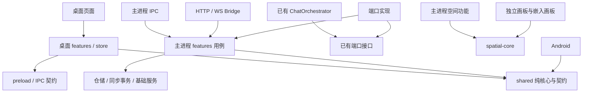

# 项目结构优化实施方案

> 日期：2026-10-02
>
> 状态：⚠️ 待处理 — 本文为实施方案，尚未执行本轮结构改造。
>
> 范围：PC 主仓、shared 子仓，以及空间画板的公共核心与构建边界；Android 仅承接共享契约兼容验证和子模块指针更新。
>
> 前置成果：[项目冗余清理最终实施报告](../报告/项目冗余清理最终实施报告-2026-10-02.md)。本方案承接其遗留项，不重复执行已经完成的转发层删除、工具登记与清理脚本改造。

## 1. 目标与实施范围

目标是让每类业务拥有明确的实现位置、稳定的跨模块入口和可验证的依赖方向，使桌面端、共享核心及独立画板可以分别修改和构建。

本轮交付包括：

1. 对齐三仓拓扑、子模块初始化、依赖安装和 CI 构建入口。
2. 清除共享业务核心中的桌面 IPC 调用与界面 store 状态。
3. 将画板纯领域核心提取为 PC 主仓内的本地包，供桌面端与独立画板共同使用。
4. 分离主进程聊天的传输、用例、持久化职责，并将空间服务按业务归组。
5. 按职责拆分群聊流控制器、聊天 store 和画板 store。
6. 接入已经抽取的联验公共设施，并建立依赖边界检查。

保持当前 PC 根目录入口与三个 Git 仓库，不同时进行整个仓库的 `apps/` 搬迁、框架升级或存储格式升级。React 18 桌面端与 React 19 独立画板先保留各自依赖和构建环境；后续统一依赖管理需要单独评估。

结构改造应保持已有行为：单聊与群聊生成、功能 AI 会话隔离、空间提交确认与撤销、备份恢复、跨端同步和旧格式读取。只有验证发现具体缺陷时，才在独立修复批次中调整行为。

## 2. 当前结构与问题证据

以下是本次工作区检查结果；其中包含未提交修改，不能视为 GitHub 主分支现状。实施阶段 0 必须重新记录提交和工作区基线。

| 现状 | 证据位置 | 对修改的影响 | 处理方向 |
|---|---|---|---|
| 顶层界面、主进程、共享逻辑已经分层 | `src/`、`electron/`、`shared/` | 基本结构可以继续使用 | 保留顶层，细化模块职责 |
| 对话编排已有端口 | `electron/chat/ports.ts`、`orchestrator.ts` | 可以在稳定接口后迁移实现 | 复用端口，避免再建同职责编排体系 |
| shared 中仍有桌面调用 | `shared/chat-core/aiInputHelper.ts` 中 `window.api.ai.*`；`lorebook.ts` 中缓存 `refresh()`；`tokenCounter.ts` 中精确 IPC 计数 | 共享模块不能在无桌面环境中完整使用 | 平台调用归宿主，核心接收数据或接口 |
| 共享层包含渲染状态接口 | `shared/chat-core/chatTypes.ts` 的 `ChatState` 和 store set/get 类型 | 界面动作变化会牵动共享仓库 | 界面状态归 `src/features/chat`，领域类型留 shared |
| 主进程与界面导入画板内部源码 | `electron/services/spatial*.ts`、`backup.ts`、`src/components/chat/SpatialBoardPane.tsx` | 画板内部调整会影响宿主 | 提取稳定空间领域包 |
| 聊天 IPC 同时做文件与业务操作 | `electron/ipc/chat.ts` 的文件读取、锁、实体映射、领域提交和 IPC 注册 | IPC、Bridge 和编排器的复用边界不清楚 | 传输薄层 → 用例 → 仓储 |
| 空间服务平铺在通用服务目录 | `electron/services/spatialRepository.ts`、`spatial*AiService.ts`、`spatial*DialogueQueue.ts` 等 | 同一业务分散，通用目录持续膨胀 | 归入 `electron/features/spatial` |
| 多职责模块较大 | 世界书约 2300 行、画板 store 约 2000 行、群聊流控制器约 1760 行、聊天 IPC 约 1500 行 | 定位和修改成本较高；行数本身不能证明应拆分 | 先记录职责和修改耦合，再逐项拆分 |
| 仓库描述与实际拓扑不一致 | `.gitmodules` 挂载 shared/android，根 README 与推送规范仍有单仓描述 | 新克隆和发布流程可能漏掉子模块 | 文档以实际 Git 拓扑为准 |
| CI 未显式初始化子模块 | `.github/workflows/ci.yml`、`release.yml` 的 checkout | 新检出可能缺少共享源码 | 明确递归检出与固定提交验证 |
| 依赖分属不同安装入口 | 根 pnpm workspace 仅登记 Relay；画板有独立 npm 锁文件 | 根安装不能代表画板依赖已经安装 | 先明确双安装流程，再决定是否统一 |
| 联验公共设施尚未接入 | `scripts/lib/browserHarness.mjs`；清理最终报告 §5 | 启动器继续重复实现，旧 UI 断言会超时 | 更新流程后逐脚本接入 |

已有清理报告登记了两项测试失败：`w9Shadow.integration.test.ts` 与 `SpatialBoardPane.test.tsx`。这是报告中的历史基线，本次未重新运行测试。实施时必须复验，禁止将其自动视为可忽略结果。

## 3. 目标目录与依赖规则

### 3.1 目标目录

下列目录代表最终职责；各阶段按文件消费者迁移，不一次性创建空目录或复制实现。

```text
qingyu/                         # PC 主仓，继续保留当前开发入口
├── src/
│   ├── pages/                  # 路由和页面组合
│   ├── components/             # 通用组件；存量业务组件逐批迁移
│   ├── features/
│   │   ├── chat/               # 单聊状态、流订阅、功能任务适配
│   │   ├── group-chat/         # 群聊状态、调度、流与消息收尾
│   │   ├── spatial/            # 画板嵌入和宿主交互
│   │   └── lorebook/           # 界面缓存与 IPC 数据加载
│   └── lib/                    # 日志、通用 IPC 适配等基础设施
├── electron/
│   ├── ipc/                    # 注册、参数校验、返回值/错误映射
│   ├── bridge/                 # HTTP/WS 传输适配
│   ├── chat/                   # 已有编排器、任务生命周期和端口
│   ├── features/
│   │   ├── chat/               # 会话用例、仓储、实体映射
│   │   └── spatial/            # 仓储、提交、上下文、助手与提取队列
│   ├── domain/                 # 现有同步领域、事务与恢复
│   └── services/               # 存储、日志、模型适配等基础服务
├── packages/
│   └── spatial-core/           # 无 React/Electron/PC 契约依赖的纯领域包
├── spatial-board/              # 独立编辑器与嵌入编辑器
│   └── src/                    # UI、canvas、store、保存与嵌入适配
├── shared/                     # qingyu-shared 子模块
│   ├── chat-core/              # 跨宿主纯业务算法与领域接口
│   ├── lorebook/               # 世界书格式、领域校验和适配
│   ├── domain/                 # 跨端领域契约
│   ├── contracts/              # 同步/业务协议与 schema
│   └── fixtures/               # 跨端兼容与 golden 数据
├── android/                    # qingyu-android 子模块，内部再挂载 shared
├── relay-server/               # 独立部署服务，保留现有 workspace
├── server/                     # 公告服务，保留独立安装/部署方式
├── scripts/lib/                # 浏览器/Electron 联验公共设施
├── tests/                      # 跨模块、golden、集成验证
└── docs/                       # 规范、方案和报告
```

### 3.2 依赖方向



具体约束：

- shared 纯核心禁止直接访问 `window`、DOM、Electron、React、Zustand、Node 文件系统或 PC 源码。IPC 类型声明可以留在 shared 的专用契约入口，核心算法不引用完整 IPC API 作为领域类型来源。
- `spatial-core` 只处理空间文档、命令、校验、迁移、投影和领域历史，不读取用户文件、不调用模型、不维护 React store，也不依赖 shared。
- 桌面端与画板通过 `@qingyu/spatial-core` 的公开导出使用空间核心，不导入对方应用的内部路径。
- 主进程 IPC 与 Bridge 调用同一用例/仓储入口；共享写路径继续遵守现有领域提交、journal、文件锁和恢复规则。
- 已有对话编排器与单聊/群聊职责继续存在；本轮不以“统一”为理由合并不同生命周期。
- 业务 feature 通过明确的用例或类型入口协作；跨 feature 导入其内部实现、新增循环依赖均视为边界问题。

### 3.3 空间核心包的构建选择

建议包名 `@qingyu/spatial-core`，在根 pnpm workspace 中登记 `packages/spatial-core`。包提供编译后的 ESM 与类型声明，主进程 esbuild 将其打入 CJS 产物；独立画板通过本地 `file:../packages/spatial-core` 依赖安装编译后的包。此阶段保留画板的 npm 锁文件。

所有构建流程明确执行“核心包构建 → 消费者安装/构建”；开发模式在核心修改时重建并刷新画板的本地依赖，验证 npm 本地依赖是否为复制或链接，不能假设自动更新。打包结果不得依赖源码路径、工作区链接或外置核心文件。

若本地包复制机制导致开发体验或 CI 不稳定，阶段 2 先验证打包安装的方案，再决定统一画板至 pnpm workspace。禁止同时升级 React 或静默改用另一个解析入口。阶段 2 的完成条件包含实际开发更新与干净构建验证。

## 4. 分阶段实施

### 阶段 0：冻结基线并修正仓库/构建入口

**工作：**

1. 记录 PC、shared、Android 及 Android 内 shared 的 HEAD、分支、工作区修改与子模块指针；将现有未提交成果与本轮结构改造分开登记。不得通过 reset、checkout 或清理覆盖在途代码。
2. 记录当前测试结果、两项历史失败的实际状态、依赖锁文件与桌面/画板构建入口。保存证据到 `output/structure-refactor/phase0/`。
3. 修正根 README、推送规范及开发备忘录中的仓库拓扑。明确 shared 有两个固定提交挂载点，PC 与 Android 在迁移期间可以使用不同兼容版本，但要登记原因和升级顺序。
4. 调整需要 shared/android 的 CI 和 Release checkout，显式递归初始化；失败时报告缺失仓库或提交。仅涉及 Relay/独立画板的 job 可按实际依赖选择检出范围。
5. 为当前 PC 多入口构建明确安装画板依赖的步骤。验证桌面 React 与画板 React 的解析边界，分别检查两个页面产物，而非只检查独立画板构建。
6. 在现有成果形成可检出提交后，用干净目录验证递归克隆、固定锁文件安装、检查和构建；不能用本地有 node_modules 的结果替代。

**完成条件：** 仓库拓扑描述一致；基线可复现；测试失败已分类；CI 所需安装和检出流程完整。

**回退：** 独立回退文档与工作流批次，不触碰已有业务改动。

### 阶段 1：共享核心去平台依赖

**文件与职责迁移：**

| 当前入口 | 目标处理 | 验证重点 |
|---|---|---|
| `shared/chat-core/aiInputHelper.ts` | 配置与消息组装的纯函数继续共享；`callAiHelper()` 的订阅、取消和 IPC 请求移至桌面 AI 适配模块 | requestId 过滤、取消、监听释放、失败清理、thought 处理一致 |
| `shared/chat-core/lorebook.ts` 的缓存/refresh | 抽出桌面世界书缓存与 IPC 加载；领域匹配、预算、缓存键纯计算留核心 | 会话切换、版本失效、语义缓存隔离；确认全部缓存消费者后迁移 |
| `shared/chat-core/tokenCounter.ts` | 启发式估算留 shared；精确 IPC 计数归桌面适配，调用方注入计数接口 | 正常精确计数及失败估算回退行为一致 |
| `shared/chat-core/chatTypes.ts` | 完整 `ChatState`、界面任务及 set/get 类型归桌面 feature；上下文、预算、消息等跨宿主 DTO 单独保留 | shared 无渲染状态依赖，Android 消费者仍可编译 |
| `shared/chat-core` 对 `ipc-api` 的类型引用 | 必要 DTO 移到领域类型入口，IPC 层引用该入口 | 避免同义类型复制，类型调用方一致迁移 |

每次迁移先区分纯计算与平台操作，再迁移消费者与测试 mock。shared 的公共导出若发生删除或移动，先列出 PC、Android 和 Android/shared 的消费者；跨仓提交与子模块指针分批衔接。

继续使用已存在的日志 sink 等注入机制。只有真实存在多个宿主或需要替换的能力才增加接口，不为每个函数建立 DI 层。模块级缓存要明确属于哪个进程/会话，不能为迁移省事引入新的跨会话共享单例。

**完成条件：** 共享业务核心运行无需 `window.api`；无 React/Zustand store 类型；Node 环境能直接执行纯算法测试；跨端契约与 golden 不漂移；旧实现与旧消费者同时退出。

**回退：** PC 与 shared 以配套提交回退；Android 的指针单独回退。若必须保留兼容入口，登记消费者和退出批次，阶段完成前清除已无消费者的入口。

### 阶段 2：提取空间领域核心

**工作：**

1. 迁移 `spatial-board/src/core/` 的实现与对应测试到 `packages/spatial-core`；评估并迁移 `persistence/importGuard.ts` 中纯文本解析、大小/深度与文档校验。File/Blob、文件选择、本地草稿与自动保存继续留在编辑器。
2. 保留现有文档格式、命令语义、限制和迁移行为。公开导出至少覆盖 `SpatialCoreState`、命令/文档类型、校验、`applyCommandBatch`、工厂、迁移、投影和 import guard。
3. 更新所有主进程、桌面界面、画板、测试、评测脚本及动态 import；消费者只通过包公开入口使用核心。移除旧实现路径，禁止维护两份 reducer 或 validation。
4. shared 的 `spatial.ts` / `spatial-ai.ts` 继续承担宿主提交与功能任务协议，使用现有可序列化边界，不依赖 PC 仓库的本地空间包。宿主在接收数据时调用核心校验并映射结果。
5. 调整画板边界检查：允许纯 `@qingyu/spatial-core`，继续禁止 PC 运行时和 shared 反向依赖；新增核心包自身的纯依赖检查。
6. 更新根 Vite 多入口、画板 Vite、TypeScript、esbuild、测试配置、watch 与 CI paths。核心包改动必须触发 PC 和画板回归。
7. 验证开发时修改核心可生效，独立画板、嵌入画板和 Electron 生产包均能加载同一份核心语义；检查依赖树和产物，避免把 React、Zustand 或宿主依赖带入核心包。

**完成条件：** PC 不再引用 `spatial-board/src`；画板不依赖 PC 运行时；核心包无 UI/宿主依赖；序列化 fixture 一致；独立/嵌入/生产三条构建链均通过。

**回退：** 目录迁移、消费者、锁文件和构建配置作为同一可回退批次；格式保持兼容，无数据迁移要求。

### 阶段 3：主进程职责分离

先拆聊天，再归组空间，分成独立子批次。

**聊天目标：**

- `electron/features/chat/chatRepository.ts`：会话和消息读取、分页、索引与持久化。写操作复用当前事务/锁与 `commitThroughDomain`，避免绕过同步 journal。
- `electron/features/chat/sessionUseCases.ts`：创建、修改、删除与恢复会话；生命周期通知仍通过现有 `chatLifecycle` 协作。
- `electron/features/chat/messageUseCases.ts`：消息修改、swipe、导出与派生状态失效。
- `electron/features/chat/entityMapping.ts`：消息/会话与同步实体映射，保持已有字段和裁剪规则。
- `electron/ipc/chat.ts`：参数边界、注册与错误映射；Bridge、编排器端口实现直接使用用例，不反向导入 IPC 注册模块。

**空间目标：**

- `electron/features/spatial/repository.ts`：文档、运行状态、收据与事务恢复。
- `commitService.ts`：命令应用、版本核对、幂等提交与撤销。
- `contextService.ts`：单聊/群聊位置投影与预算。
- `ai/`：单聊/群聊助手服务、协议和调度。
- `dialogue/`：正文提取协议、单聊/群聊持久队列与 checkpoint。
- `electron/ipc/spatial.ts`：传输适配；备份模块通过明确的空间备份接口协作。

具体文件名可随实际职责微调。先保留原算法和调用时序完成迁移，再独立处理有证据的重复代码；单聊、群聊、editor owner 和恢复围栏不得简单合并。

**完成条件：** 聊天 IPC 不再承担仓储实现；Bridge 与编排器复用用例；空间文件归属明确；锁范围、事务、取消、来源版本、幂等与备份恢复回归通过。

**回退：** 聊天和空间分别提交，消费者与实现一起回退；保持 IPC channel、返回值和磁盘格式兼容。

### 阶段 4：界面状态与流控制按业务拆分

**先处理群聊流控制器：**

- `streamSession.ts`：活动请求、监听、计时器、终态 latch、取消与清理。
- `requestRunner.ts`：请求快照、预算、模型请求和恢复调用。
- `messageFinalizer.ts`：完整正文处理、自由发言拆分、保存和重生成替换。
- `modeScheduler.ts`：点名/轮询/自由发言调度，复用 shared 已有纯调度算法。
- 功能 AI、空间提取和记忆调度由已有接口衔接，避免相互直接修改内部状态。

先对活动请求状态和回调契约形成明确类型，再逐段迁移。保留请求/会话级取消、迟到事件幂等、重生成失败恢复和完整正文保存时序。

**再处理桌面与画板 store：**

- `useChatStore`、`useGroupChatStore` 保留对页面的稳定状态入口，按会话动作、消息动作、生成动作逐批拆分到各自 feature。
- `spatialStore` 按命令/历史、选择/视口、编辑意图、宿主提交/保存和剧情建议拆分 slice 或控制器。所有领域写入继续进入核心命令，不能直接改 nodes/placements。
- 页面仅组合 feature 状态与组件。迁移一个业务域时，更新该域的测试、动态导入和 mock，完成后删除旧路径，不长期保留通用 store 目录中的转发壳。

世界书大模块另按匹配、预算、诊断、压缩及格式适配核对；优先承接阶段 1 中的平台缓存分离，再决定剩余拆分。类型大文件仅在对应业务迁移时拆分，不一次性重排全部 shared 类型。

**完成条件：** 每个拆出的模块有清晰输入输出；无新增循环依赖；界面状态与领域计算分离；单聊、三种群聊模式、取消/重试、画板确认/冲突/撤销/保存失败行为一致。文件行数记录变化，不设硬性“每文件多少行”的通过标准。

**回退：** 群聊流、单聊 store、画板 store 分别成批，禁止在同一批中同时迁移三条链路。

### 阶段 5：联验工具接入与边界门禁

1. 核对 `scripts/lib/browserHarness.mjs` 当前能力，修正最终清理报告登记的旧 UI 断言，再逐个接入画板各阶段启动器。公共层负责启动、就绪、浏览器、结果和收尾；场景保留自己的 mock 与断言。
2. 对重复的 Electron 启动设施抽取 `scripts/lib/electronHarness.mjs`，统一 bundle、临时用户目录、进程日志与退出。继续遵守当前数据隔离与证据保留规则。
3. 建议新增 `pnpm check:boundaries`：检查静态/动态导入、命名 re-export、路径别名及实际解析后的跨目录依赖。纯文本匹配作为辅助，不能单独证明依赖闭环。
4. 检查至少覆盖：shared/core 平台依赖、PC 对画板内部路径依赖、画板对 PC/shared 反向依赖、features 循环和传输层内新增仓储写实现。例外记录理由、消费者和退出条件，禁止宽泛忽略整个目录。
5. 将现有 `check:forwarders`、契约检查、写路径检查按实际适用范围接入 CI；验证负例确实使检查失败。生产检查、工具检查与测试 mock 区分范围，避免将测试替身误报为生产依赖。

**完成条件：** 每个迁移启动器独立 smoke 通过；公共设施能回收资源；人为引入违例能被门禁拦截；没有测试文件通过排除规则消失。

### 阶段 6：干净环境验收与文档收口

1. 按新拓扑从固定提交递归检出，完成 PC、核心包、画板、shared 消费者及受影响 Android 的验证。
2. 更新 README、开发/检查命令、目录说明、工具登记和 CI 触发范围；归档本方案并记录每阶段提交、验收证据和遗留项。
3. 全量测试保持硬门禁。阶段间可以记录已确认基线失败，但最终结构改造验收须修复或证明断言已过时并更新对应测试，不将“两项既有失败”无限延续为默认例外。
4. 对真实模型仅在请求组装、生成/取消时序或功能队列发生实质变化时执行相关场景；纯目录/导入迁移使用确定性测试和浏览器 smoke。需要真实模型时使用隔离数据与当前已授权配置，不读取或展示凭据。
5. 核对各仓提交可获取，shared 先形成可消费提交，PC/Android 再更新各自指针；发布前从远程固定提交复验。方案写入本身不代表提交、合并、推送或发版已经完成。

## 5. 验证矩阵

| 批次 | 必做检查 | 关键行为证据 |
|---|---|---|
| 基线/仓库入口 | 子模块状态、固定锁文件安装、`pnpm check`、PC/Electron/画板构建 | 干净检出可复现，多入口依赖齐全 |
| shared 去平台依赖 | 定向 Vitest、shared Node 环境测试、契约/golden、PC 类型检查、受影响 Android 单测 | 精确计数回退、缓存失效、AI 监听清理与跨端兼容 |
| 空间核心提取 | 核心单测/fixture、画板 schema/boundary、独立/嵌入浏览器、PC 备份/空间测试、生产构建 | 命令语义、导入限制、版本冲突、提交收据与撤销一致 |
| 主进程职责分离 | 聊天/Bridge/编排器、写路径检查、事务/同步恢复、备份测试 | 幂等、文件锁、journal、删除/恢复围栏不变 |
| 流控制/store 拆分 | 单聊/群聊/store 定向测试、浏览器交互、终态/取消/恢复场景 | 迟到事件只收尾一次，失败重生成恢复，群聊模式行为一致 |
| 工具与门禁 | 各启动器 smoke、公共设施失败路径、边界负例 | 无残留进程和监听，不写真实用户数据 |
| 最终验收 | `pnpm check`、`pnpm lint`、`pnpm test:coverage`、`pnpm build`、`node electron-build.mjs`、画板检查/浏览器/构建与新增包检查 | 无新增失败，最终门禁全绿，干净安装包可运行 |

现有命令还包括 `node scripts/check-contracts.mjs`、`node scripts/check-write-bypass.mjs`、`pnpm check:forwarders`，执行前确认其覆盖仓库与输出。新增 `check:boundaries`、核心包构建和聚合检查属于计划交付，不表示这些命令当前已存在。

每阶段输出报告到 `docs/报告/项目结构优化阶段N实施报告-YYYY-MM-DD.md`，日志归 `output/structure-refactor/phaseN/`。报告写明基线提交、实际改动、命令/结果、失败分类、行为差异、回退提交及未完成条件。

## 6. 提交与回退规则

- 先核对在途工作归属，结构改造不夹带功能扩展或模型/框架升级。
- 每批围绕一个可验证职责，目录迁移与消费者更新一起提交，避免“只搬文件”的中间提交无法构建。
- 跨仓修改登记 PC/shared/Android 的配套提交与指针。不能仅更新主仓 gitlink 而遗漏 shared 源码提交。
- 合并前查看目标分支与实际提交差异；不能用“分支名相同”或“本地 HEAD 相同”证明最新工作区已合入。
- 回退结构批次通常不需要回退用户数据。若某批次提出数据格式变化，移出本方案，建立单独迁移和回退方案。
- 工具/产物按已有白名单规则处理；本轮不顺带删除模型、备份、凭据或有效验证证据。

## 7. 执行顺序与完成清单

推荐顺序：阶段 0 → 1 → 2 → 3（聊天、空间分批）→ 4（群聊、单聊、画板分批）→ 5 → 6。边界检查随每阶段逐步建立，阶段 5 再形成统一 CI 入口；联验工具可在实际回归需要时提前接入对应场景。

优先完成阶段 0—2：这三阶段解决可复现构建、共享核心和画板核心边界。后续职责拆分以真实修改耦合和回归结果决定批次，不依靠目录或行数完成指标。

- [ ] 阶段 0：仓库拓扑、在途基线与干净构建入口对齐。
- [ ] 阶段 1：shared 核心移除桌面调用与界面状态。
- [ ] 阶段 2：空间核心单一实现，PC/画板只依赖公共包。
- [ ] 阶段 3A：聊天 IPC、用例与仓储分离。
- [ ] 阶段 3B：空间服务按职责归组。
- [ ] 阶段 4A：群聊流控制器分离请求、状态、收尾与调度。
- [ ] 阶段 4B：单聊/群聊状态与业务 feature 对齐。
- [ ] 阶段 4C：画板 store 拆分并保留命令写入口。
- [ ] 阶段 5：公共联验设施接入，边界门禁负例验证通过。
- [ ] 阶段 6：跨仓固定提交、全量检查、干净生产构建及文档归档完成。
